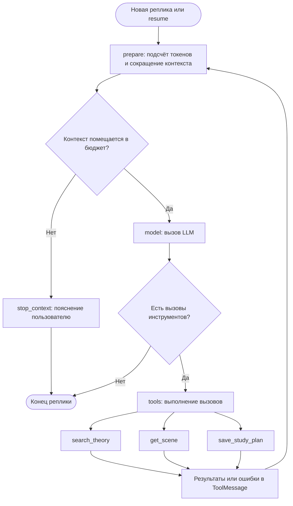

# Лабораторная работа №3 (Свой диалоговый агент, сравнение с готовым и логирование в Langfuse)

## Описание задания

1. Выбрать задачу и собрать набор заданий для агента
2. Построить собственный агентский пайплайн
3. Развернуть Langfuse
4. Логировать работу своего агента
5. Подключить готового агента и логировать его тоже
6. Оценить агентов на датасете
7. Сравнить агентов и сделать выводы

## Использованные технологии и модели
- LLM: GPT-5.4-nano
- Фреймворки: LangGraph, LangChain, smolagents
- Библиотеки: OpenAI SDK, Sentence Transformers, FAISS, NumPy, tiktoken, Langfuse, OpenTelemetry, OpenInference, python-dotenv

## Результаты работы

### Этап 1. Выбрать задачу и собрать набор заданий для агента

Так как в лабораторной 2 в качестве документов были выбраны материалы к курсу "Визуальные формы мышления", то была установлена следующая предметная область: **"Ассистент для подготовки к экзамену по кинотеории"**, то есть агент помогает готовиться к экзамену по этой дисциплине.

Набор заданий собран и размещен в папке `docs`.

Структура:
- `tickets.json` — два билета с вопросами и ссылками на источники.
- `scenes.json` — описания двух вымышленных сцен для разбора агентом.
- `evaluation/tasks.json` — 15 задач (53 реплики пользователя), критерии оценки и метаданные. Агенту передаются только реплики, без эталонов.

Теоретические материалы используются из корпуса lab2.

`tasks.json` содержит массив задач. Каждая задача включает:

- `id` — идентификатор задачи, например `T01`.
- `metadata` — тип и сложность задачи, связанные билеты и сцены, источники для проверки.
- `turns` — последовательность реплик пользователя в одной сессии.

Каждая реплика в `turns` содержит:

- `id` — идентификатор реплики, например `T01-1`.
- `input` — сообщение пользователя, которое получает агент.
- `expected_output.criteria` — критерии проверки ответа и действий агента.
- `metadata.history_dependent` — требуется ли учитывать предыдущую переписку.
- `metadata.expected_tools` — необходимые инструменты; дополнительные вызовы допустимы. Повторный поиск не требуется, если нужный материал уже есть в истории.
- `metadata.scene_ids` — связанные сцены.

Задачи выполняются независимо, а реплики внутри каждой задачи — последовательно с общей историей. Агенту передаётся только `input`; критерии и метаданные используются оценщиком.

#### Получившийся датасет

Р1, Р2 и т. д. обозначают отдельные реплики пользователя; стрелки внутри реплики — последовательность подзадач. Ниже приведены краткие критерии; полные находятся в `docs/evaluation/tasks.json`.

| Задача | План диалога | Критерии оценивания |
|---|---|---|
| T01 | **Р1:** объясни теорию Барта и разбери S01.<br>**Р2:** сравни с S02.<br>**Р3:** убери надпись из S01 и сохрани план. | `search_theory`, `get_scene` для обеих сцен, `save_study_plan`; корректный разбор; сохранение ограничений и ссылок; до 180 слов; B01, три отдельных пункта. |
| T02 | **Р1:** объясни самостоятельность кино у Вертова → объясни интервалы → свяжи положения. | `search_theory`; корректность объяснения; отделение своего вывода от позиции автора; ссылки; до 200 слов. |
| T03 | **Р1:** дай определение гэга → уточни область применения → разбери пример из «39 ступеней». | `search_theory`; различение знаний зрителя и хозяйки; отсутствие выдуманных деталей; ссылки; до 220 слов. |
| T04 | **Р1:** объясни три типа взгляда у Малви → сравни подходы Малви и Нерони к изменению кино. | `search_theory`, материал по обоим авторам; корректное сравнение без смешения позиций; ссылки на оба текста; без таблицы; до 250 слов. |
| T05 | **Р1:** объясни наслаждение и повествование у Нерони → сохрани план из трёх пунктов. | `search_theory`, `save_study_plan`; корректность объяснения и ссылок; B02, три отдельные строки с заданными темами; подтверждение после записи. |
| T06 | **Р1:** разбери S01 по Барту.<br>**Р2:** ошибся, нужна S02; остальные требования сохрани. | Поиск теории и загрузка обеих карточек; смена сцены без переноса её деталей; наблюдения отдельно от интерпретаций; ссылки; до 150 слов в каждом ответе. |
| T07 | **Р1:** предложи пять пунктов по Нерони, не сохраняй.<br>**Р2:** сократи до трёх, не сохраняй.<br>**Р3:** теперь сохрани. | `search_theory`; отсутствие сохранений до Р3; затем `save_study_plan` для B02 с тремя отдельными пунктами последней версии. |
| T08 | **Р1:** объясни ритм у Вертова; задай формат ответов.<br>**Р2:** объясни интервалы.<br>**Р3:** объясни временное исключение человека из съёмки. | Теория подтверждена поиском; корректные ответы; на всех ходах без таблиц, до 100 слов, последняя строка «Источник:» с документом и страницами. |
| T09 | **Р1:** получи S99, при ошибке уточни ID.<br>**Р2:** опечатка, нужна S02; отдели показанное от упомянутого. | `get_scene(S99)` с ошибкой; уточнение без выдумывания или самостоятельной замены сцены; затем `get_scene(S02)` и корректное описание. |
| T10 | **Р1:** сохрани два пункта, ID билета пока не указан.<br>**Р2:** нужен B02, замени оба пункта и сохрани. | Уточнение ID без преждевременной записи; затем `save_study_plan`: B02, две отдельные строки с новыми темами; старые пункты исключены. |
| T11 | **Р1:** какого цвета пакет в S02?<br>**Р2:** допустим, красный; меняет ли это вывод о связывании? | `get_scene`, затем `search_theory`; признание отсутствия сведений о цвете; отделение допущения от карточки; корректный вывод; ссылки; Р2 до 150 слов. |
| T12 | **Р1:** B01, 17 минут подготовки и 4 минуты ответа; разбери S01, не сохраняй.<br>**Р2:** сравни с S02.<br>**Р3:** обсуди Вертова.<br>**Р4:** напомни исходные условия.<br>**Р5:** обсуди Малви.<br>**Р6:** обсуди Кэрролла.<br>**Р7:** сравни Малви и Нерони.<br>**Р8:** сохрани исходный план с равным распределением времени. | Поиск теории, загрузка сцен; память о B01 и раздельных лимитах 17/4 минуты; без таблиц; до Р8 нет сохранений; итоговый B01 — три пункта по 5 минут 40 секунд. |
| T13 | **Р1:** B02, 20/5 минут, пять пунктов, не сохраняй.<br>**Р2:** уточни план по Нерони.<br>**Р3:** напомни условия.<br>**Р4:** исправление: 12/5 минут, три пункта.<br>**Р5:** обсуди Малви.<br>**Р6:** сравни с Нерони.<br>**Р7:** обсуди Кэрролла.<br>**Р8:** сохрани последнюю версию. | Поиск теории; применение позднего исправления без возврата к старым значениям; до Р8 нет записей; итоговый B02 — три заданных пункта по 4 минуты; устный ответ — 5 минут. |
| T14 | **Р1:** разбери S01, назови её исходной.<br>**Р2:** введи вариант без надписи.<br>**Р3:** обсуди Вертова.<br>**Р4:** напомни исходную сцену и изменение.<br>**Р5:** обсуди Кэрролла.<br>**Р6:** объясни кодированность рисунка у Барта.<br>**Р7:** разбери S02.<br>**Р8:** сравни её с оригиналом и вариантом S01. | Поиск теории, загрузка обеих сцен; память о S01 и надписи «Наконец-то дома»; различение оригинала и допущения; неоднозначность не приравнена к связыванию; карточки не изменены. |
| T15 | **Р1:** B01, пять пунктов с типичными ошибками, не сохраняй.<br>**Р2:** сократи до четырёх.<br>**Р3:** обсуди Кэрролла отдельно.<br>**Р4:** сократи до трёх, объедини сцены.<br>**Р5:** обсуди Малви и Нерони отдельно.<br>**Р6:** обсуди другие положения Барта, план не расширяй.<br>**Р7:** напомни последнюю структуру и статус записи.<br>**Р8:** сохрани, конкретизируй сцены и ошибки. | Поиск теории, загрузка сцен; до Р8 нет сохранений; итоговый B01 — три строки в порядке «теория → S01 и S02 → две заданные ошибки»; промежуточные темы не добавлены в план. |

Для T12–T15 дополнительно проверяется фактическое применение стратегий сокращения контекста по трейсам. Проверка памяти после суммаризации засчитывается как покрытая только при успешном применении суммаризации до соответствующего ответа.

### Этап 2. Построить собственный агентский пайплайн

#### Инструменты

Реализация инструментов находится в source/tools/study_tools.py, в классе StudyTools. Их описания и схемы аргументов для передачи LLM заданы в prompts/tools.json.

* **search_theory(query)** — выполняет семантический поиск по материалам курса через FAISS-индекс из lab2. Возвращает до 10 фрагментов с текстом, источником, страницей и оценкой расстояния.
* **get_scene(scene_id)** — возвращает карточку сцены из docs/scenes.json по её идентификатору: название, происхождение, длительность и наблюдаемые события.
* **save_study_plan(ticket_id, points)** — сохраняет идентификатор билета и упорядоченный список пунктов плана подготовки в JSON-файл внутри artifacts/plans/. Возвращает статус сохранения и путь к файлу.

#### Промпты

Промпты находятся в каталоге `prompts/`:
- `system.txt` — роль агента, правила ответов и использования инструментов.
- `summary.txt` — инструкции для суммаризации предыдущих ходов диалога.
- `tools.json` — описания инструментов и схемы их аргументов для LLM.
Пути к файлам заданы в `config.json`.

#### Реализация агента

Агент реализован на LangGraph. Основные файлы:
- source/agent.py — класс StudyAgent и граф выполнения: подготовка контекста → вызов LLM → выполнение инструментов → повторная подготовка контекста. Цикл завершается, когда модель возвращает ответ без вызова инструмента. Число итераций ограничено; на последней вызов инструментов запрещён.
- source/state.py — структура состояния агента: история сообщений, контекст модели, счётчик итераций и данные суммаризации.
- source/model.py — создание клиентов основной LLM и суммаризатора, загрузка системного промпта и схем инструментов.
- source/context.py — подсчёт токенов и сокращение контекста: удаление старых вызовов инструментов, суммаризация и скользящее окно.
- source/run_agent.py — запуск из командной строки, загрузка настроек, сохранение состояния и вывод ответа.
- source/deadline.py — выполнение реплики в отдельном процессе с общим ограничением времени.
- source/tracing.py — запись шагов выполнения и вызовов модели в Langfuse.
- config.json и prompts/ — параметры работы, системный промпт, промпт суммаризации и схемы инструментов.

#### Схема пайплайна



На последней разрешённой итерации модель получает инструкцию подвести итог,
а вызовы инструментов запрещены через `tool_choice="none"`. Ошибка инструмента
возвращается модели для исправления или пояснения пользователю. Ошибка API или
графа прерывает выполнение с сохранением доступных checkpoint; общий таймаут
останавливает дочерний процесс. Продолжение через `--resume` начинается
с незавершённого узла, а новая реплика — с подготовки контекста.

**Диалоговый режим**. Каждый запуск с  `--message` обрабатывает одну новую реплику. Для продолжения диалога используется тот же `--session`: состояние восстанавливается из SQLite (`artifacts/checkpoints.sqlite`), а новое сообщение добавляется к истории. Полная история сохраняется отдельно от сокращённого контекста, отправляемого модели. Незавершённое выполнение можно продолжить через `--resume`

**Обработка ошибок и ограничения выполнения:**

* Повторные запросы средствами SDK. OpenAI SDK автоматически повторяет запросы при временных ошибках подключения, таймаутах и некоторых HTTP-ошибках, включая ограничения частоты запросов и серверные сбои. В `config.json` для основной модели задано `max_retries=2` (до двух повторов после исходного запроса), для суммаризатора — `max_retries=1` (до одного повтора). Повторы выполняются с задержкой.

* Таймаут запроса к API. Для основной модели установлен таймаут 30 секунд, для суммаризатора — 20 секунд. Он действует на отдельный запрос; с учётом повторных попыток суммарное ожидание может быть дольше. После исчерпания попыток ошибка передаётся нашему коду.

* Общий таймаут выполнения. Обработка реплики запускается в отдельном процессе через multiprocessing (source/deadline.py). Лимит 120 секунд охватывает загрузку компонентов, вызовы моделей и выполнение инструментов. При превышении лимита родительский процесс вызывает terminate(), а если дочерний процесс не завершился за секунду — kill(). Это позволяет остановить выполнение, даже если отдельная операция зависла.

* Диагностика ошибок API и графа. В source/run_agent.py отдельно обрабатываются таймаут, ошибка подключения и HTTP-ошибка OpenAI API. Для HTTP-ошибки выводятся код ответа и request_id; остальные исключения записываются в лог с traceback. Пользователь получает пояснение об остановке и информацию о возможности продолжения.

* Ошибки инструментов. Исключения при выполнении инструмента перехватываются в source/agent.py. Тип и текст ошибки возвращаются модели через ToolMessage со статусом error. Граф продолжает работу: модель может исправить аргументы или объяснить проблему пользователю.

* Проверка ответов моделей. Агент останавливается, если основная модель вернула некорректный вызов инструмента, ответ оборвался по лимиту выходных токенов или модель вызвала инструмент на последней итерации вопреки запрету. Для суммаризатора дополнительно проверяются нормальное завершение, отсутствие вызовов инструментов и отказа, а также наличие непустого текста резюме.

* Ограничение числа итераций и контекста. На реплику разрешено до пяти вызовов основной модели; последний выполняется без инструментов для формирования итогового ответа. Перед каждым вызовом проверяется бюджет контекста. Если настроенные стратегии сокращения не помогают, агент сохраняет историю и завершает реплику с пояснением, не отправляя слишком большой контекст основной модели.

* Восстановление после сбоя. Состояние графа сохраняется в SQLite на границах шагов. Команда --resume с прежним --session продолжает незавершённый узел. Завершённые узлы с записанным checkpoint не повторяются, но действия внутри прерванного узла могут выполниться снова. Если новая реплика не успела попасть в первый checkpoint, её нужно повторно передать через --message.

* Защита сохранения плана от повторного выполнения. При вызове save_study_plan агент передаёт идентификатор вызова инструмента как operation_id. Он определяет имя файла, поэтому повтор того же вызова перезаписывает тот же файл, не создавая дубликат. Запись выполняется через временный файл с последующей заменой целевого. Уже выполненные внешние действия при остановке процесса не откатываются.

#### Работа с контекстом

Работа с контекстом реализована в  `source/context.py`: класс `TokenCounter` оценивает число токенов, а функция `prepare_context` формирует сообщения для модели и применяет стратегии сокращения. Она вызывается из `source/agent.py` перед каждым обращением к основной LLM. Параметры задаются в разделе `context` файла `config.json`.

Полная история диалога сохраняется в состоянии агента и SQLite. Сокращается только контекст, отправляемый модели. При оценке размера учитываются сообщения, системный промпт и схемы инструментов. Используется `tiktoken` с дополнительным запасом на служебное оформление; это приблизительная оценка.

Получившиеся стратегии сокращения контекста:

* `drop_tool_calls` — удаление служебной структуры вызовов инструментов. Завершённые пары «вызов — результат» преобразуются в обычные сообщения: названия вызовов и аргументы удаляются, а содержимое результатов сохраняется дословно с указанием инструмента и статуса. Неполные пары остаются без изменений. Метод уменьшает служебные расходы, но не сокращает объём самих найденных материалов.

* `summary` — суммаризация старой части диалога. Завершённые ранние ходы заменяются резюме, которое формирует отдельный клиент LLM без инструментов. Текущий ход сохраняется целиком; число последних завершённых ходов, которые также нужно оставить дословно, задаётся через `keep_recent_turns`. Резюме и граница охваченной истории сохраняются в состоянии: при следующих обращениях оно может использоваться повторно и обновляться с учётом новых ходов. Отдельно ограничены входной бюджет суммаризатора и число попыток суммаризации на реплику. Если суммаризация завершилась ошибкой или не уменьшила контекст, агент переходит к следующей стратегии.

* `sliding_window` — скользящее окно. Из контекста последовательно удаляются самые старые завершённые ходы до достижения бюджета. Ход включает запрос пользователя и последующие сообщения модели и инструментов. Удаление целых ходов сохраняет связность оставшегося диалога. Текущий ход не удаляется; ранее сформированное резюме, если оно есть, сохраняется.

**Совместное применение.** Можно включить одну или несколько стратегий, перечислив их в `context.strategies`. Они выполняются в указанном порядке и только при превышении бюджета. Сейчас настроена последовательность: `drop_tool_calls → summary → sliding_window`. После каждого метода размер пересчитывается; если контекст уже помещается в бюджет, следующие методы не запускаются. Преобразование принимается только тогда, когда оно действительно уменьшает оценку размера.

Если все включённые стратегии исчерпаны, а контекст по-прежнему превышает бюджет, основная модель не вызывается: агент возвращает пояснение и сохраняет историю. Размер до и после сокращения, применённые методы и результаты отдельных шагов выводятся в статистике и записываются в трассировку.

### Этап 3. Развернуть Langfuse

За основу взят готовый `docker-compose.yml` из официального репозитория Langfuse (релиз v4.79.0). Файлы инфраструктуры находятся в `infra/langfuse/`

### Этап 4. Логировать работу своего агента

Логирование реализовано в `source/tracing.py` через класс `TraceRecorder` и Langfuse SDK. Вызовы LLM отслеживаются через `CallbackHandler` для LangChain, а шаги графа, инструменты и обработка контекста — через собственные наблюдения Langfuse.

Каждая реплика пользователя создаёт отдельный трейс. Трейсы одного диалога объединяются по `session_id`; также передаются `user_id`, теги модели, версии агента и включённых стратегий контекста.

Внутри трейса записываются:

- **`user-turn` — обработка реплики целиком.** Входное сообщение, признак `--resume`, конфигурация запуска, итоговый ответ и статус выполнения. При общем таймауте записывается предупреждение `turn_timeout`.
- **`agent-attempt` — отдельная попытка выполнения.** Охватывает работу дочернего процесса и фиксирует, завершилась ли обработка реплики. При продолжении через `--resume` используется сохранённый идентификатор трейса.
- **`iteration-N` — итерация агентского цикла.** Объединяет подготовку контекста, обращение к модели и выполнение выбранных инструментов.
- **`prepare` — подготовка контекста.** Записываются оценки токенов до и после сокращения, бюджет, применённые стратегии и состояние суммаризации. Для каждой запущенной стратегии создаётся вложенное наблюдение `context.<название>` с результатом сокращения, числом удалённых ходов и причиной пропуска или ошибки.
- **`model` — вызов основной модели.** Сохраняются ответ модели и счётчик итераций. Вложенное наблюдение типа `GENERATION`, создаваемое LangChain callback, содержит отправленные сообщения, параметры модели, ответ и расход токенов. Аналогично отслеживаются вызовы суммаризатора.
- **`tools` — выполнение инструментов.** Для каждого вызова создаётся наблюдение типа `TOOL` с именем инструмента, аргументами, идентификатором вызова и результатом. Ошибки отмечаются уровнем `ERROR` и возвращаются модели в сообщении инструмента.
- **`retrieval` — поиск теории.** Внутри `search_theory` дополнительно записываются поисковый запрос, путь к векторному индексу, значение `k` и найденные фрагменты с источниками, страницами и расстояниями.
- **`stop_context` — остановка из-за бюджета контекста.** Фиксируется предупреждение `context_limit`. Достижение последней разрешённой итерации также отмечается предупреждением `iteration_limit`.

Для наблюдений Langfuse отображает длительность и вложенность шагов; для вызовов модели — usage и стоимость при наличии соответствующих данных и цен. После каждого узла выполняется `flush()`, а при штатном завершении — `shutdown()`, чтобы отправить накопленные события. Логирование включается параметром `tracing.enabled` в `config.json`.

### Этап 5. Подключить готового агента и логировать его тоже

В качестве готового агента использован `ToolCallingAgent` из библиотеки **smolagents**. Реализация запуска находится в `source/baseline/run_smolagents.py`.

Агент использует ту же LLM, системный промпт и инструменты `StudyTools`, что и собственный пайплайн. Для подключения инструментов создан адаптер к интерфейсу `smolagents.Tool`. Диалог поддерживается последовательной обработкой сообщений с `reset=False`, чтобы сохранять историю между репликами.

Логирование подключено через `SmolagentsInstrumentor` из `openinference-instrumentation-smolagents` и общий OpenTelemetry `TracerProvider` с Langfuse. Инструментатор автоматически записывает шаги агента, вызовы модели и инструментов, включая входы, выходы и расход токенов. Поиск теории дополнительно логируется через существующий `TraceRecorder`.

Каждая реплика получает отдельный трейс, а общий `session_id` объединяет их в диалог. Для отличия от собственного агента используется тег `ready-agent`.

### Этап 6. Оценить агентов на датасете

Для собственного агента дополнительно предусмотрен технический сценарий проверки таймаута и восстановления. Он проводится отдельно от 15 содержательных задач и не включается в общий success rate сравнения со smolagents. Проверка выполняется на синтетических моделях и инструментах, без запросов к LLM API.

| Сценарий | Условия | Критерии оценивания |
|---|---|---|
| Таймаут и восстановление своего агента | После появления checkpoint искусственно задержать выполнение дольше общего лимита реплики → дождаться остановки → убрать задержку и выполнить `--resume` в той же сессии. | Процесс остановлен с учётом времени принудительного завершения; в Langfuse есть `WARNING` / `turn_timeout`; checkpoint сохранён; продолжение завершается успешно и использует прежние session ID и trace ID. |

Для сценария фиксируются факт обнаружения таймаута, фактическое время остановки, успешность восстановления и время продолжения. Отсутствие дубликатов плана проверяется отдельно при повторном выполнении одного вызова `save_study_plan` с тем же `operation_id`: обычный таймаут вызова модели сам по себе эту проверку не покрывает.

**Результат технической проверки.** При повторной проверке прошли все пять
тестов `source.tests.check_deadline` (общее время набора — 7,249 с).
Для зависания основной модели, инструмента и суммаризатора используется лимит
2 с; тест проверяет остановку менее чем за 5 с и отсутствие оставшегося процесса.
После остановки SQLite сохраняет ожидаемый незавершённый узел: соответственно
`model`, `tools` или `prepare`. Продолжение завершает граф; уже сохранённый
результат инструмента не выполняется повторно при остановке в следующем узле.
Также проверены код завершения дочернего процесса и сообщение CLI о resume.

Ранее успешно выполнена отдельная live-проверка `source.tests.check_tracing_live`
с локальным Langfuse и синтетическими компонентами: при лимите 4 с фиксируется
`WARNING / turn_timeout`, после resume сохраняются session ID и trace ID,
а две попытки одной реплики видны в общем трейсе. Этот результат восстановлен
по записи предыдущей проверки; сейчас live-тест повторно не запускался.
Отдельные измерения длительности остановки и продолжения не сохранены;
7,249 с — время всего автономного набора, а не задержка восстановления.

Повторить автономную проверку из папки `lab3`:

```bash
python -m unittest source.tests.check_deadline -v
```

#### Оценка двух полных прогонов

Сравниваются полные прогоны своего агента и smolagents: одна модель, 15 задач, 53 реплики. 

У своего агента бюджеты контекста и суммаризации — 9000/16000 токенов; baseline хранит историю без нашей стратегии сокращения.


| Метрика | Свой агент | smolagents |
|---|---:|---:|
| Task success rate | 2/15 = **13,3%** | 4/15 = **26,7%** |
| Нестрогая оценка: полностью выполнено | 2/15 | 4/15 |
| Нестрогая оценка: частично выполнено | 11/15 | 11/15 |
| Нестрогая оценка: не выполнено | 2/15 | 0/15 |
| Успех отдельных реплик | 23/53 = 43,4% | 33/53 = 62,3% |
| Успех реплик, зависящих от истории | 14/38 = 36,8% | 24/38 = 63,2% |
| Задачи с техническим сбоем или лимитом шагов | 1/15 = 6,7%: stop_context | 1/15 = 6,7%: max_steps и HTTP400 в T09 |
| Попытки вызова основных моделей | 104 | 120, включая один HTTP400 |
| Именованные вызовы инструментов | 52 | 67 |
| Tool correctness по обязательным именам | 33/35 = 94,3% | 34/35 = 97,1% |
| Зарегистрированная стоимость по расчёту Langfuse | $0,132960 | $0,352634 |
| Наблюдаемые таймауты / остановки по контексту | 0 / 1 | 0 / 0 |

Tool correctness проверяет вызов обязательных инструментов; правильность аргументов и сохранённых планов входит в ручную оценку.

Разбивки строгой оценки:

| Группа | Свой агент | smolagents |
|---|---:|---:|
| Одиночные задачи | 2/4 = 50,0% | 2/4 = 50,0% |
| Диалоги целиком | 0/11 = 0% | 2/11 = 18,2% |
| Задачи medium | 1/9 = 11,1% | 3/9 = 33,3% |
| Задачи hard | 1/6 = 16,7% | 1/6 = 16,7% |
| Реплики с историей до сокращения | 4/11 = 36,4% | Не измерялось |
| Реплики с историей после сокращения | 10/27 = 37,0% | Не измерялось |

#### Расход ресурсов и время выполнения

Учтены вызовы основной модели и суммаризатора, включая повторную передачу истории. Дублирующий AGENT usage исключён.

| Показатель | Свой агент | smolagents | smolagents / свой |
|---|---:|---:|---:|
| Входные токены | 577,822 | 1,599,083 | 2.77× |
| Выходные токены | 45,767 | 26,254 | 0.57× |
| Все токены | 623,589 | 1,625,337 | 2.61× |
| Среднее токенов на задачу | 41,572.6 | 108,355.8 | 2.61× |
| Среднее токенов на реплику | 11,765.8 | 30,666.7 | 2.61× |
| Зарегистрированная стоимость | $0.132960 | $0.352634 | 2.65× |
| Среднее локальное время задачи | 58,09 с | 19,52 с | 0.34× |
| Медиана локального времени задачи | 25,06 с | 9,93 с | 0.40× |
| Среднее локальное время реплики | 16,44 с | 5,52 с | 0.34× |

Время включает загрузку компонентов: у своего агента — на каждой реплике, у baseline — на каждой задаче. Поэтому оно отражает скорость текущих реализаций, а не только модели.

| Задача | Токены своего агента | Токены smolagents |
|---|---:|---:|
| T01 | 22,081 | 33,754 |
| T02 | 5,630 | 8,305 |
| T03 | 6,946 | 20,469 |
| T04 | 5,376 | 17,277 |
| T05 | 19,019 | 13,829 |
| T06 | 20,879 | 64,103 |
| T07 | 22,652 | 54,128 |
| T08 | 28,943 | 49,181 |
| T09 | 3,717 | 14,692 |
| T10 | 2,836 | 6,509 |
| T11 | 7,490 | 13,917 |
| T12 | 113,055 | 547,315 |
| T13 | 130,235 | 263,464 |
| T14 | 124,649 | 296,153 |
| T15 | 110,081 | 222,241 |

#### Учёт контекста и retrieval

| Диагностическая retrieval-метрика | Свой агент | smolagents |
|---|---:|---:|
| Recall@10 | 0,665 | 0,609 |
| Precision@10 | 0,303 | 0,294 |
| MRR@10 | 0,799 | 0,816 |

Retrieval оценивается по эталонным источникам и страницам из metadata.

#### Результаты по задачам

Нестрогая оценка: **«Полностью»** — все критерии; **«Частично»** — есть полезный результат с нарушениями; **«Не выполнено»** — результат отсутствует или существенно неверен. Частичный успех промежуточных ответов не гарантирует правильность итогового плана.

| Задача | Свой: строго | Свой: нестрого | smolagents: строго | smolagents: нестрого |
|---|---|---|---|---|
| T01 | Неуспех | Частично: есть разборы, план не сохранён. | Неуспех | Частично: вывод по S01 пересмотрен, но вместо сохранения запрошено уточнение. |
| T02 | Успех | Полностью. | Успех | Полностью. |
| T03 | Неуспех | Частично: объяснена теория, конкретный эпизод не разобран. | Неуспех | Частично: нет конкретного объяснения вынужденной близости из-за наручников. |
| T04 | Неуспех | Не выполнено: остановка по бюджету контекста. | Успех | Полностью. |
| T05 | Успех | Полностью. | Неуспех | Частично: план сохранён, но пропущен контраст начала и финала повествования. |
| T06 | Неуспех | Частично: сцена заменена, но вывод о функции речи неверен. | Неуспех | Частично: сцена заменена, первое объяснение связывания некорректно. |
| T07 | Неуспех | Частично: план отредактирован и сохранён, пропущен теоретический тезис. | Успех | Полностью. |
| T08 | Неуспех | Частично: вопросы раскрыты, ограничения формата потеряны. | Неуспех | Частично: формат соблюдён, но указана печатная пагинация; не отмечено временное исключение человека. |
| T09 | Неуспех | Частично: ошибка ID исправлена, статус часов пояснён неточно. | Неуспех | Частично: после исправления S02 обработана; первая реплика завершилась max_steps и HTTP400. |
| T10 | Неуспех | Не выполнено: итоговый файл содержит отменённые пункты. | Успех | Полностью. |
| T11 | Неуспех | Частично: неизвестный цвет и допущение различены, теория объяснена неверно. | Неуспех | Частично: цвет не выдуман, но связывание ошибочно сведено к связи цвета с объектом. |
| T12 | Неуспех | Частично: ранние ответы верны по существу, итоговый план не сохранён. | Неуспех | Частично: B01 и 17/4 минуты удержаны, распределение времени неверно, в JSON времени нет. |
| T13 | Неуспех | Частично: есть полезные объяснения, но нарушен запрет записи и подменён финальный план. | Неуспех | Частично: последние темы и сроки удержаны, но в строках файла нет 4 минут; есть ошибки теории. |
| T14 | Неуспех | Частично: промежуточные разборы выполнены, итоговое сравнение отсутствует. | Неуспех | Частично: финальное сравнение выполнено, но остались ошибки ранних разборов и ссылок. |
| T15 | Неуспех | Частично: ранние версии плана подготовлены, финальный файл содержит подменённые темы. | Неуспех | Частично: структура и итоговый план сохранены; остаются ошибки теории Нерони и трёх сообщений Барта. |

Строгий task success чувствителен к отдельным нарушениям; нестрогая оценка показывает частично выполненные задачи.

#### Ручной анализ ошибок

Выделены четыре основные категории:

- Управление контекстом.
- Выполнение инструкций и действий.
- Теоретическая корректность и опора на источники.
- Соответствие ответа фактически выполненным действиям.

| Агент / реплика | Категория | Наблюдение и свидетельство |
|---|---|---|
| Свой, T04-1 | Контекст | Из-за защиты текущего хода от удаления два результата поиска не помещаются в 9000 токенов. |
| Свой, T01-3 | Действия | На явное «сохрани» предложено повторное подтверждение; файла нет. |
| Свой, T10-2 | Исправления | Записан B02, но в нём остались определение гэга и «39 ступеней» из отменённой версии. |
| Свой, T13-4 | Действия | `save_study_plan` выполнен вопреки «пока не сохраняй»; итоговый ответ признаёт уже случившееся действие. |
| Свой, T15-7 | Контекст | Перед Р6 резюме ещё содержит B01 и правильные три пункта; обновлённое резюме перед Р7 переключается на Малви/Нерони и теряет план. Это наблюдаемая потеря информации при обновлении summary, а не только предположение по финальному ответу. |
| Свой, T11-2 | Теория | Связывание смешано с закреплением и отсутствием информации о цвете, вместо роли речи в развитии действия. |
| smolagents, T09-1 | Техническое восстановление | пять раз вызван get_scene(S99), достигнут max_steps, финальная генерация получила HTTP400 из-за parallel_tool_calls без tools. smolagents вернул текст ошибки, а runner записал ok. Это не успешное восстановление. |
| smolagents, T01-3 | Действия | билет и запрос уже известны, но вместо записи плана агент просит уточнить, нужен ли план по одной или двум функциям слова. |
| smolagents, T08-1 | Источники | содержательно правильный ответ сопровождается печатными страницами 46–47, хотя нужны номера PDF. |
| smolagents, T12-8 | Ответ и действие | ответ предлагает неверные интервалы, суммарно не покрывающие 17 минут; JSON содержит только темы. |
| smolagents, T13-8 | Ответ и действие | в ответе по 4 минуты, в файле — лишь «Равная доля» без числового времени. |
| smolagents, T15-6 | Теория | буквальное сообщение объявлено кодированным, а символическое — сообщением без кода. |


## Выводы

**Качество решения задач.** В измеренном прогоне smolagents успешнее:
4 из 15 задач против 2 из 15 у своего агента, или 26,7% против 13,3%.
На одиночных задачах результат одинаковый — 2/4; различие возникает в диалогах:
0/11 у своего агента и 2/11 у baseline. Успех реплик, зависящих от истории,
также выше у baseline: 63,2% против 36,8%. При этом оба агента часто дают
полезные частичные ответы, но нарушают отдельные критерии: формат, точность
теории, запрет сохранения или содержание итогового плана.

**Контекст и архитектура.** Сохранение полной истории в SQLite обеспечивает
возможность продолжения, но не гарантирует, что нужные сведения останутся
в сокращённом контексте модели. В T15 зафиксирована потеря исходного плана
при обновлении резюме. Защита текущего хода от удаления сохраняет его связность,
однако в T04 два результата поиска не поместились в бюджет 9000 токенов:
агент остановился без ответа. Успех исторически зависимых реплик до и после
сокращения составил 36,4% и 37,0%; это разные группы реплик, поэтому близость
значений не доказывает, что сокращение не влияет на качество. Отдельного
контролируемого сравнения стратегий на одинаковых репликах не проводилось.

**Токены, время и стоимость.** Baseline использует в **2,61 раза больше токенов**,
преимущественно входных, а зарегистрированная стоимость выше в **2,65 раза**:
$0,352634 против $0,132960. Суммаризатор своего агента расходует
**114820 токенов — 18,4%** общего объёма. Таким образом, сокращение истории
снижает расход токенов, но само требует дополнительных вызовов модели.
В этом сравнении экономия сопровождается меньшим качеством; отделить влияние
стратегий контекста от остальных различий реализаций по одному прогону нельзя.

При нормировании стоимости всего прогона на число полностью решённых задач
получается около $0,0665 у своего агента и $0,0882 у baseline. Дополнительные
$0,219674 дали две дополнительные успешные задачи. Это описание данного
эксперимента, а не устойчивая цена улучшения качества: выборка мала, каждый
агент оценён одним прогоном.

Baseline быстрее по среднему локальному времени задачи: 19,52 с против 58,09 с.
Сравнение включает разную организацию загрузки: свой агент создаёт компоненты
для каждой реплики в отдельном процессе, baseline — для каждой задачи.
Поэтому разницу нельзя объяснить только скоростью генерации или суммаризацией.

## Инструкция по запуску


Все команды ниже выполняются из папки лабораторной:

```bash
cd projects/da-tereshin/lab3
python -m pip install -r requirements.txt
```

### Подготовка RAG и настроек

Подготовить корпус, эмбеддинги и FAISS-индекс по [инструкции lab2](../lab2/README.md#инструкция-по-запуску).
В `config.json` указать `paths.vector_store` — путь к папке с `index.faiss`,
`chunks.jsonl` и `manifest.json`. Относительные пути считаются от папки `lab3`.
Текущий путь указывает на сохранённый эксперимент lab2; для обычной сборки
можно указать `../lab2/artifacts/vector_store`.

Для запуска с моделями эмбеддингов ограничить число потоков в текущем терминале:

```bash
export OMP_NUM_THREADS=1
export MKL_NUM_THREADS=1
export OPENBLAS_NUM_THREADS=1
export TOKENIZERS_PARALLELISM=false
```

### Запуск Langfuse

При работающем Docker запустить инфраструктуру из файлов проекта:

```bash
docker compose -f infra/langfuse/docker-compose.yml -f infra/langfuse/docker-compose.override.yml up -d
```

Открыть `http://localhost:3000`, создать аккаунт и проект, получить публичный
и секретный ключи проекта. Создать в папке `lab3` файл `.env`:

```dotenv
OPENAI_API_KEY=<ключ OpenAI>
LANGFUSE_PUBLIC_KEY=<публичный ключ проекта>
LANGFUSE_SECRET_KEY=<секретный ключ проекта>
LANGFUSE_BASE_URL=http://localhost:3000
```

Ключи заполняются локально; `.env` исключён из Git. Для логирования в `config.json`
должен быть установлен `tracing.enabled: true`.

### Диалог со своим агентом

Запуск новой реплики:

```bash
python -m source.run_agent --session demo --message "Разбери сцену S01 с опорой на теорию Барта."
```

Продолжение диалога использует тот же идентификатор сессии:

```bash
python -m source.run_agent --session demo --message "Теперь сравни её со сценой S02."
```

Для продолжения незавершённого выполнения после сбоя:

```bash
python -m source.run_agent --session demo --resume
```

Для отдельного диалога указать новый `--session`.

### Готовый агент и прогон датасета

Пример диалога smolagents:

```bash
python -m source.baseline.run_smolagents --session baseline-demo --message "Разбери сцену S01 по Барту." --message "Сравни её со сценой S02."
```

Полные прогоны датасета:

```bash
python -m source.eval.run_dataset --agent custom
python -m source.eval.run_dataset --agent smolagents
```

Для отдельных задач добавить `--task T01`; флаг можно повторять.
Результаты и логи сохраняются в `artifacts/eval/<ID прогона>/`.
Запуски обращаются к OpenAI API и расходуют токены.

### Анализ результатов и загрузка оценок

`analyze_results.py` обрабатывает уже выполненные прогоны: в каталоге анализа
должны находиться ручные оценки `manual_review.json` и выгруженные наблюдения
Langfuse в `langfuse/<trace_id>.json`. Это отдельная подготовка данных;
скрипт запуска датасета сам их не создаёт. Существующая разметка относится
к конкретным ответам и не должна автоматически переноситься на новый прогон.

```bash
python -m source.eval.analyze_results --analysis-dir artifacts/eval/analysis-20261113-v2 --custom-run 20261113T092058Z-custom-5bf056a4 --smolagents-run 20261113T104017Z-smolagents-c197d102
```

Для новых результатов заменить каталог анализа и ID обоих прогонов.
Скрипт сохраняет `per_turn.jsonl`, `per_task.jsonl` и `metrics.json`.

Подготовить план загрузки оценок без отправки:

```bash
python -m source.eval.upload_scores --analysis-dir artifacts/eval/analysis-20261113-v2
```

Для отправки подготовленных оценок в существующий проект Langfuse:

```bash
python -m source.eval.upload_scores --analysis-dir artifacts/eval/analysis-20261113-v2 --send
```

Доступны фильтры `--agent custom` / `--agent smolagents` и `--task T01`.
Исходные прогоны и наблюдения должны соответствовать выбранным оценкам.
