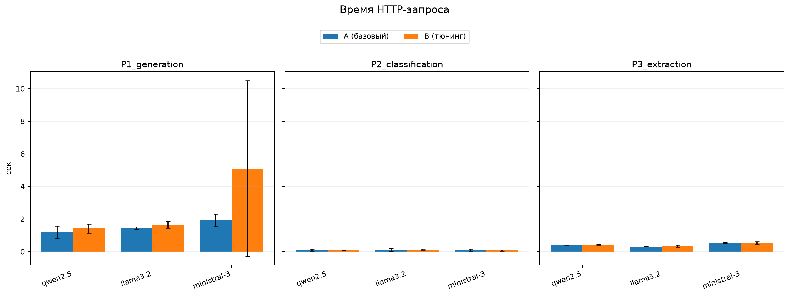
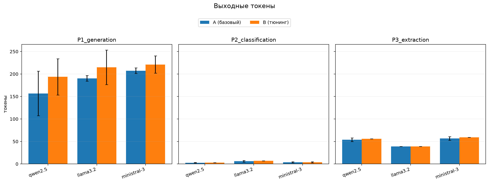
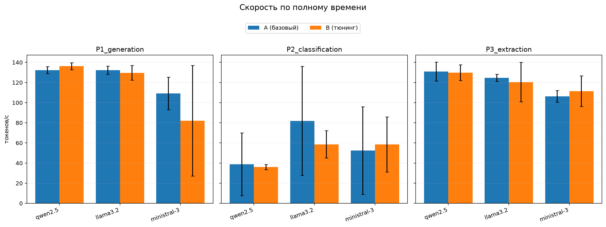
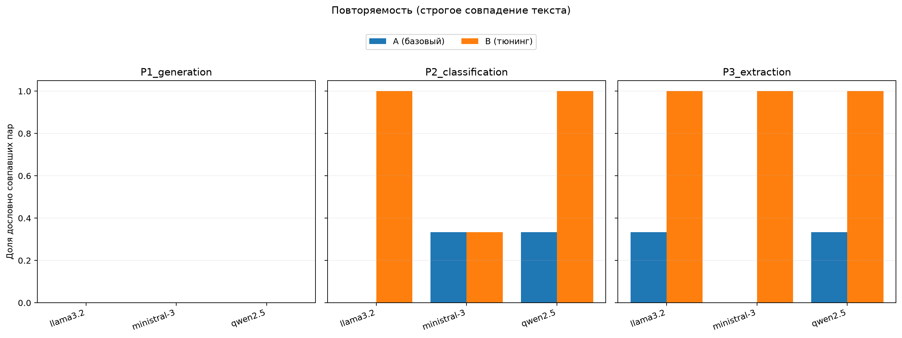

# Лабораторная работа №1

## Описание задания

Цель работы - развернуть локально три LLM разных семейств с OpenAI-совместимым REST API и эмпирически сравнить их на русскоязычных задачах генерации, классификации и извлечения данных.

Для каждой модели и каждого запроса выполнены базовый и настроенный прогоны по три повтора. Сохранены ответы, время выполнения, число входных и выходных токенов, скорость генерации и причина завершения.

## Использованные технологии и модели

- Python 3.12.3;
- Ollama - локальный запуск моделей и OpenAI-совместимый API `http://localhost:11434/v1`;
- OpenAI Python SDK - обращения к API;
- pandas и NumPy - агрегация результатов;
- Matplotlib - построение графиков.

| Семейство | Модель |
| --- | --- |
| Qwen | `qwen2.5:3b-instruct` |
| Llama | `llama3.2:3b` |
| Mistral | `ministral-3:3b` |

## Результаты работы

### Экспериментальная схема

Использованы три запроса:

1. **P1 - генерация:** вежливое письмо.
2. **P2 - классификация:** фиксированный список меток и короткие входные тексты.
3. **P3 - извлечение:** извлечь поля из описания товара.

| Режим | Параметры |
| --- | --- |
| A - базовый | Параметры Ollama по умолчанию |
| B - тюнинг | `temperature=0.2`, `max_tokens=256` |

Перед измерениями каждая модель прогревалась отдельным запросом. Выполнено 54 из 54 запланированных запросов без ошибок. В таблицах приведены средние значения по трём повторам. Скорость рассчитана как число выходных токенов, делённое на полное время HTTP-запроса, и включает накладные расходы API.

### P1 - генерация письма

| Модель | Режим | Время, с | Выходные токены | Токенов/с | Совпадение повторов |
| --- | --- | ---: | ---: | ---: | ---: |
| Qwen | A | 1,187 | 156,7 | 132,3 | 0 % |
| Qwen | B | 1,420 | 193,7 | 136,2 | 0 % |
| Llama | A | 1,440 | 190,3 | 132,3 | 0 % |
| Llama | B | 1,649 | 214,7 | 129,6 | 0 % |
| Ministral | A | 1,934 | 207,3 | 109,2 | 0 % |
| Ministral | B | 5,097 | 221,0 | 82,0 | 0 % |

Все модели сформировали письма требуемой структуры, но качество русского текста различалось.

- У Qwen встречались грамматические ошибки, а в одном настроенном ответе появилась отсутствующая в запросе дата «12 января 2023».
- Один настроенный ответ Llama достиг лимита 256 токенов и завершился с причиной `length`.
- Ministral в одном базовом прогоне перешла на английский язык; в остальных ответах встречались отдельные языковые ошибки.

Тюнинг не сделал творческую генерацию дословно воспроизводимой. Средняя длина выросла у Qwen на 24 %, у Llama на 13 %, у Ministral на 7 %. Высокое среднее время Ministral в режиме B вызвано выбросом одного прогона - 11,3165 с против 1,7639–2,2098 с в двух других.

### P2 - классификация

| Модель | Режим | Время, с | Выходные токены | Токенов/с | Совпадение повторов |
| --- | --- | ---: | ---: | ---: | ---: |
| Qwen | A | 0,102 | 2,7 | 38,8 | 33 % |
| Qwen | B | 0,083 | 3,0 | 36,1 | 100 % |
| Llama | A | 0,111 | 6,0 | 81,9 | 0 % |
| Llama | B | 0,125 | 7,0 | 58,6 | 100 % |
| Ministral | A | 0,097 | 3,7 | 52,5 | 33 % |
| Ministral | B | 0,072 | 3,7 | 58,5 | 33 % |

- Qwen в базовом режиме один раз ошибочно выбрала `Billing`, а после снижения температуры трижды вернула точную метку `Tech support`.
- Ministral во всех прогонах определила категорию верно по смыслу, но иногда добавляла Markdown-выделение.
- Llama не соблюдала фиксированный список меток: возвращала `Tech support.`, `Техподдержка.` и один раз ошибочное `Технаумия.`. Поэтому 100% повторяемости Llama в режиме B означает стабильность текста, но не точное соблюдение контракта.

### P3 - извлечение данных

| Модель | Режим | Время, с | Выходные токены | Токенов/с | Совпадение повторов |
| --- | --- | ---: | ---: | ---: | ---: |
| Qwen | A | 0,410 | 53,7 | 130,9 | 33 % |
| Qwen | B | 0,432 | 56,0 | 129,8 | 100 % |
| Llama | A | 0,313 | 39,0 | 124,7 | 33 % |
| Llama | B | 0,330 | 39,0 | 120,5 | 100 % |
| Ministral | A | 0,534 | 56,7 | 106,3 | 0 % |
| Ministral | B | 0,536 | 59,0 | 111,4 | 100 % |

- Qwen во всех ответах вернула валидный JSON с корректными значениями; базовые ответы различались только форматированием.
- Llama правильно извлекла данные, но записывала цвет на английском (`black`), а один раз - японским иероглифом (`黒`).
- Ministral корректно извлекла данные в настроенном режиме, но оборачивала объект в Markdown-блок, формально нарушая требование «только JSON». В одном базовом ответе Ministral указала `null` вместо названия товара.

Низкая температура дала наиболее заметный эффект на структурированном ответе: точное совпадение трёх повторов достигло 100 % у каждой модели. Вымышленных характеристик товара не обнаружено; ошибки относились к пропуску значения, языку и формату.

### Производительность и артефакты

Число входных токенов у Ministral (623–687) значительно выше, чем у Qwen (96–125) и Llama (91–110). Это связано с различиями токенизаторов и шаблонов чата, поэтому значения разных семейств нельзя напрямую трактовать как одинаковый объём полезного текста. У одного прогона Ministral P1 в режиме B зафиксировано 667 входных токенов вместо обычных 623 - ещё одна аномалия измерения.









Полные данные:

- [ответы всех прогонов](source/results/responses.jsonl);
- [метрики прогонов](source/results/metrics.csv);
- [агрегированные метрики](source/results/plots/summary.csv);
- [показатели повторяемости](source/results/plots/repeatability.csv).

## Выводы

1. Все три модели успешно работали через локальный OpenAI-совместимый API и выполнили полный набор запросов без технических ошибок.
2. Qwen лучше остальных соблюдала формат: после настройки она трижды вернула точную метку и стабильный корректный JSON. Слабое место - качество русского текста в свободной генерации.
3. Llama была самой быстрой на извлечении, но хуже соблюдала контракт классификации и нестабильно выбирала язык значения цвета. Лимит `max_tokens=256` один раз оборвал письмо.
4. Ministral верно классифицировала запрос по смыслу, но добавляла Markdown-разметку к метке и JSON. У неё также самое большое число входных токенов и самый заметный временной выброс.
5. Температура 0,2 повысила повторяемость классификации и извлечения, но не обеспечила детерминизм генерации. Изменение `max_tokens` проявилось прежде всего как верхняя граница длины.
6. Для строгих машинных контрактов необходимы проверка допустимой метки, разбор JSON и повторный запрос при ошибке формата.

## Инструкция по запуску

Требуются Python 3.12, `uv` и установленная Ollama. Команды выполняются из каталога лабораторной.

1. Перейти в каталог:

   ```bash
   cd projects/ek_chernov/lab1
   ```

2. Создать окружение и установить зафиксированные зависимости:

   ```bash
   python -V
   python -m venv .venv
   source .venv/bin/activate
   pip install -r requirements.txt
   ```

3. Запустить Ollama в отдельном терминале:

   ```bash
   ollama serve
   ```

4. Загрузить модели:

   ```bash
   python source/download_models.py
   ```

5. Выполнить 54 запроса:

   ```bash
   python source/main.py
   ```

6. Построить таблицы и графики:

   ```bash
   python source/visualize_results.py
   ```

Ответы и метрики сохраняются в `source/results`, графики и сводные таблицы - в `source/results/plots`. Повторный запуск `source/main.py` дописывает записи в `responses.jsonl`, поэтому для независимого эксперимента следует заранее сохранить старый файл отдельно.
