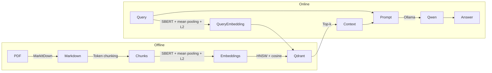
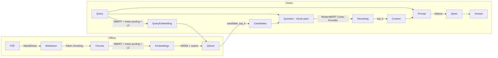

# Лабораторная работа №2 — RAG по сборнику рецептов

Проект преобразует PDF в Markdown, строит dense-индексы, загружает их в Qdrant, сравнивает retrieval-стратегии и отвечает через локальную модель Ollama.

## Схема RAG системы

Используемые модели:

- SBERT: [ai-forever/sbert_large_nlu_ru](https://huggingface.co/ai-forever/sbert_large_nlu_ru) контекстное окно на 512
- Cross-Encoder: [ARGA100/ru-reranker-modernbert-small](https://huggingface.co/ARGA100/ru-reranker-modernbert-small)
- Qwen: [Qwen/Qwen2.5-3B-Instruct](https://ollama.com/library/qwen2.5:3b-instruct) контекстное окно на 128K

В `source/config/pipeline.json` секция `retrieval_models` описывает модели и
их `batch_size`, а `retrievals` — стратегии поиска. `bi` возвращает ближайшие
чанки Qdrant, `bi_n_cross` сначала получает `candidate_top_k` кандидатов через
Bi-Encoder, затем переранжирует их Cross-Encoder и оставляет итоговые `top_k`.
Каждый эксперимент обязательно ссылается на стратегию полем `retrieval`.

Cross-Encoder работает только во время запросов и оценки. При построении
индекса используется исключительно связанный `bi_encoder`; обе стратегии не
создают отдельного формата векторов.

### Baseline



### Bi-Encoder + Cross-Encoder (`bi_n_cross`)



## Схема запуска

Компоненты работают в двух окружениях:

- Windows-компьютер: Qdrant в Docker Compose;
- Ubuntu-контейнер на GPU-сервере: Python-пайплайн, SBERT и Ollama;
- доступ к Qdrant: обратный SSH-туннель.

```text
Ubuntu-контейнер:127.0.0.1:16333
              │
              │ обратный SSH-туннель
              ▼
Windows:127.0.0.1:6333 → Qdrant в Docker
```

Qdrant привязан только к localhost Windows-компьютера и напрямую в сеть не публикуется.

## Требования

На Windows нужны Docker Desktop, Docker Compose, OpenSSH Client и запись в `.ssh\config` для VPS.

В Ubuntu-контейнере нужны Python 3.12, NVIDIA GPU с CUDA, Ollama, а для OCR — Tesseract с языковыми данными `rus`.

Основные параметры находятся в `source/config/pipeline.json`. Для малого корпуса конфигурация принудительно строит HNSW: `indexing_threshold_kb=1` и `full_scan_threshold_kb=0`. Иначе Qdrant может использовать полный перебор, при котором сравнение `M`, `ef_construct` и `ef_search` некорректно.

## Первичная подготовка Ubuntu-контейнера

```bash
cd projects/ek_chernov/lab2

uv venv --python 3.12 .venv
source .venv/bin/activate
uv pip install -r requirements.txt
```

Проверка PyTorch и GPU:

```bash
python -c "import torch; print('PyTorch:', torch.__version__); print('CUDA:', torch.version.cuda); print('GPU:', torch.cuda.get_device_name(0)); assert torch.cuda.is_available()"
```

Tesseract нужен только для запуска с `--ocr`:

```bash
sudo apt-get update
sudo apt-get install -y tesseract-ocr tesseract-ocr-rus
tesseract --list-langs
```

В списке языков должен присутствовать `rus`.

## Полный запуск системы

Команды выполняются в указанном порядке.

### 1. Запуск Qdrant на Windows

Откройте PowerShell:

```powershell
cd .\projects\ek_chernov\lab2\

$env:QDRANT_BIND_ADDRESS = "127.0.0.1"
docker compose up -d qdrant
docker compose ps
curl.exe http://127.0.0.1:6333
```

Контейнер `ek-chernov-lab2-qdrant` должен перейти в состояние `running` или `healthy`.

### 2. Открытие обратного SSH-туннеля на Windows

Откройте отдельное окно PowerShell и оставьте его работающим:

```powershell
ssh -NT `
  -o ExitOnForwardFailure=yes `
  -o ServerAliveInterval=30 `
  -o ServerAliveCountMax=3 `
  -R 127.0.0.1:16333:127.0.0.1:6333 `
  Custodian
```

Если порт `16333` занят, выберите другой и используйте его далее в `QDRANT_URL`.

### 3. Подготовка Ubuntu-контейнера

```bash
cd ./projects/ek_chernov/lab2
source .venv/bin/activate

export CUDA_VISIBLE_DEVICES=0
export QDRANT_URL=http://127.0.0.1:16333
export OLLAMA_URL=http://127.0.0.1:11434
```

Проверка Qdrant и GPU:

```bash
curl --connect-timeout 5 "$QDRANT_URL"
nvidia-smi
python -c "import torch; print(torch.cuda.get_device_name(0)); assert torch.cuda.is_available()"
```

### 4. Запуск Ollama в Ubuntu-контейнере

Если Ollama ещё не запущена, выполните в отдельном терминале:

```bash
ollama serve
```

В основном терминале:

```bash
ollama pull qwen2.5:3b-instruct
ollama list
curl --connect-timeout 5 "$OLLAMA_URL/api/tags"
```

Код лабораторной не скачивает модель автоматически.

### 5. Конвертация PDF

Реализовано два скрипта по конвертации PDF в Markdown. Один основан на фреймворке PyMuPDF, второй на основе MarkItDown.

Для использования скрипта с PyMuPDF:

По существующему текстовому слою:

```bash
python -m source.scripts.prepare_markdown_pymupdf --no-ocr
```

С принудительным русскоязычным OCR:

```bash
python -m source.scripts.prepare_markdown_pymupdf --ocr
```

CLI-флаги имеют приоритет над `use_ocr` из конфигурации. Результат: `source/data/processed/recipes.md`.

Для использования скрипта с MarkItDown:

```bash
python -m source.scripts.prepare_markdown_markitdown
```

Результат: `source/data/processed/recipes_2.md`.

### 6. Построение индексов

```bash
python -m source.scripts.build_index --config small --markdown "<path_to_md>" --rebuild
python -m source.scripts.build_index --config baseline --markdown "<path_to_md>" --rebuild
python -m source.scripts.build_index --config large --markdown "<path_to_md>" --rebuild
python -m source.scripts.build_index --config bi_n_cross --markdown "<path_to_md>" --rebuild
```

### 7. Загрузка индексов в Qdrant

Для воспроизводимого эксперимента пересоздайте коллекции. Скрипт дождётся состояния `green` и полной индексации HNSW; таймаут можно переопределить флагом `--index-timeout`:

```bash
python -m source.scripts.load_to_vector_store --config small --drop-and-reindex
python -m source.scripts.load_to_vector_store --config baseline --drop-and-reindex
python -m source.scripts.load_to_vector_store --config large --drop-and-reindex
python -m source.scripts.load_to_vector_store --config bi_n_cross --drop-and-reindex
```

Проверка коллекций:

```bash
curl "$QDRANT_URL/collections"
curl "$QDRANT_URL/collections/recipes_small"
curl "$QDRANT_URL/collections/recipes_baseline"
curl "$QDRANT_URL/collections/recipes_large"
curl "$QDRANT_URL/collections/recipes_bi_n_cross"
```

В ответе каждой коллекции `indexed_vectors_count` должен быть равен `points_count`. Если параметры существующей коллекции отличаются от конфигурации, загрузчик потребует `--drop-and-reindex`.

### 8. Подготовка ручной разметки

Заполните `source/evaluation/questions.json` пятнадцатью вопросами после просмотра Markdown:

```json
[
  {
    "id": "q01",
    "question": "Вопрос по содержимому документа",
    "relevant_pages": [1],
    "relevant_chunks": [
      "Эталонный фрагмент документа"
    ],
    "reference_facts": [
      ["обязательный факт", "допустимый вариант факта"]
    ]
  }
]
```

Номера страниц должны соответствовать маркерам `<!-- page: N -->`.
Каждый внутренний список `reference_facts` описывает один обязательный факт,
а его элементы задают допустимые формулировки. Факты должны следовать только
из `relevant_chunks`.

### 9. Оценка retrieval и генерации

```bash
python -m source.scripts.evaluate_retrieval --experiment baseline
python -m source.scripts.evaluate_retrieval \
  --experiment bi_n_cross \
  --configs baseline bi_n_cross
```

Для каждого вопроса выполняется один прогревочный и пять измеряемых поисковых
запросов, после чего Ollama формирует один ответ по всему итоговому списку
`retrievals.<name>.top_k`. Настройки повторов находятся в секции `evaluation`;
число прогревов и повторов можно переопределить флагами `--warmup-runs`
и `--repetitions`. Обязательный аргумент `--experiment` задаёт название
эксперимента в истории результатов и не изменяет настройки `pipeline.json`.

Retrieval оценивается одновременно через Precision@5, Recall@5,
Precision@10, Recall@10 и MRR. Если итоговый `top_k` меньше 10, скрипт
делает отдельный неизмеряемый retrieval до глубины 10 только для метрик;
в генерацию и измерение latency по-прежнему входит настроенный `top_k`.
Время retrieval для `bi_n_cross` включает Qdrant и реранжирование.
Полнота ответа оценивается через Fact Recall — долю
обязательных групп из `reference_facts`, для которых в нормализованном
ответе найдена хотя бы одна допустимая формулировка. Метрика не выявляет
неподтверждённые утверждения. Время поиска и генерации сохраняется отдельно.

Каждый запуск сохраняется в неизменяемом каталоге
`source/data/results/runs/<UTC timestamp>_<experiment>`:

- `result.json` — детальные метрики и ответы по вопросам;
- `report.md` — таблица и вывод для конкретного запуска.

После запуска автоматически пересобираются `leaderboard.json`,
`leaderboard.md`, `latest.json` и `best_experiment.json`. В каждой таблице
`leaderboard.md` жирным выделяются лучшие значения соответствующего запуска.
При равенстве выделяются все лучшие значения.

### 10. RAG-запрос

```bash
python -m source.scripts.rag \
  --config baseline \
  --question "Как приготовить Суп-пюре из кабачков и цветной капусты?" \
  --top-k 15 \
  --ef-search 64
```

Без `--top-k` размер выдачи берётся из выбранной retrieval-конфигурации.
Явный `--top-k` имеет приоритет. В результатах `bi_score` хранит исходный
score Qdrant, `rerank_score` — оценку Cross-Encoder, а поле `score` всегда
содержит итоговую оценку, используемую для порядка и вывода источников.

Запрос через реранжирование:

```bash
python -m source.scripts.rag \
  --config bi_n_cross \
  --question "Как приготовить суп-пюре из кабачков?"
```

По умолчанию используется конфигурация из `best_experiment.json`, а до
появления результатов или при повреждённом указателе — `baseline`.

Примеры прогонов:

```bash
lab2$ python -m source.scripts.rag \
  --config baseline \
  --question "Как приготовить Суп-пюре из кабачков и цветной капусты?"

Для приготовления супа-пюре из кабачков и цветной капусты нужно выполнить следующие шаги:

1. Репчатый лук очистить и нарезать кубиками.
2. Морковь очистить и натереть на крупной терке.
3. На разогретой сковороде на масле гхи обжарить лук и морковь.
4. Кабачки нарезать кубиками.
5. В кастрюлю положить кабачки, цветную капусту, припущенный лук и морковь, добавить соль и перец.
6. Залить овощи водой, довести до кипения и варить на небольшом огне 20 минут, добавить куркуму.
7. Готовые овощи пюрировать блендером.

Источники:
- Рецепты.pdf, стр. 64–64; score=0.6707; # ОСНОВНЫЕ БЛЮДА ## Салат из белокочанной капусты ### Способ приготовления 1. Тонко нашинковать капусту, слегка посолить. 2. Порезать укроп. 3. Смешать нашинкованную капусту и укроп, приправить оливковым маслом и перемеш
- Рецепты.pdf, стр. 58–58; score=0.6641; # ОСНОВНЫЕ БЛЮДА ## Красная рыба с брокколи ### Способ приготовления 1. Рыбу и брокколи смазать маслом, добавить соль, перец и сушеные травы. 2. Выпекать до готовности при температуре 180 градусов.
- Рецепты.pdf, стр. 53–53; score=0.6538; # ОСНОВНЫЕ БЛЮДА ## Суп-пюре из кабачков и цветной капусты. ### Способ приготовления 1. Репчатый лук очистить и нарезать кубиками. 2. Морковь очистить и натереть на крупной терке. 3. На разогретой сковороде на масле гхи 
- Рецепты.pdf, стр. 99–99; score=0.6536; # ОСНОВНЫЕ БЛЮДА ## Нутовый карри суп ### Способ приготовления 1. Слегка обжарить лук со специями и черри. 2. Затем добавить протертые томаты, молоко, овощной бульон и нут. Накрыть крышкой. 3. Спустя пару минут добавить 
- Рецепты.pdf, стр. 73–73; score=0.6532; # ОСНОВНЫЕ БЛЮДА ## Салат из редьки с огурцом и зеленью ### Способ приготовления 1. Редьку натереть на крупной терке, огурец порезать полукольцами, смешать с мелко рубленым луком. 2. Заправить оливковым маслом. 3. Посоли

lab2$ python -m source.scripts.rag \k_chernov/lab2$ python -m source.scripts.rag \
  --config long_late \
  --question "Как приготовить Суп-пюре из кабачков и цветной капусты?"

Для приготовления суп-пюре из кабачков и цветной капусты, вам потребуется следующий ингредиенты и способы приготовления, приведённые в рецепте:

### Ингредиенты:
- Фасоль белая консервированная 1 банка
- Цветная капуста предварительно запеченая 250 г.
- Соевое молоко 500 мл.
- Соль/специи по вкусу
- Чеснок 1/2 зубчика
- Кунжут черный 1 ч. ложка

### Способ приготовления:
1. Фасоль, капусту и молоко отправляем в кастрюлю, добавляем специи и оставляем тушиться на 15 минут.
2. Добавляем чеснок и погружным блендером превращаем наш суп в крем.
3. Полученный крем можно подавать, я обычно украшаю еще одним соцветием капусты и кунжутом.

Этот суп-пюре готовится на основе фасоли и запечённой цветной капусты, который тушится с соевым молоком и чесноком. Полученный суп-пюре можно подавать как самостоятельное блюдо, украшая его соцветием капусты и кунжутом.

Источники:
- Рецепты.pdf, стр. 84–84; score=0.5876; # ОСНОВНЫЕ БЛЮДА ## Тарелка с запечеными овощами и соусом из фасоли ### ингредиенты - батат 1 шт. - нут 130 г. - цветная капуста 400 г. - картофель по –деревенски - соль/специи по вкусу. ### Способ приготовления 1. Завор
- Рецепты.pdf, стр. 85–85; score=0.5853; # ОСНОВНЫЕ БЛЮДА ## Тофу скрэмбл с грибами ### ингредиенты - шампиньоны 3 шт. - лук красный 1 шт. - хлеб из зеленой гречки 100 г. - авокадо 70 г. - тофу 100 г. - куркума 1 ч. л. - соль/специи по вкусу - оливковое масло 1
- Рецепты.pdf, стр. 98–98; score=0.5785; # ОСНОВНЫЕ БЛЮДА ## Крем суп из белой фаслои и цветной капусты ### ингредиенты - фасоль белая консервированная 1 банка - цветная капуста предварительно запеченая 250 г. - соевое молоко 500 мл. - соль/специи по вкусу - че
- Рецепты.pdf, стр. 97–97; score=0.5716; # ОСНОВНЫЕ БЛЮДА ## Сливочная паста из кабачка с миндальной рикоттой ### ингредиенты - кабачок 1 шт. (небольшой) - томаты черри 7 шт. - красный лук 1 шт. - вода ~ 80 мл. (в зависимости от сочности кабачка) - миндальная р
- Рецепты.pdf, стр. 86–86; score=0.5689; # ОСНОВНЫЕ БЛЮДА ## Хумус с запеченым бататом ### ингредиенты - батат 1 шт. - нут вымоченный и - приготовленный 400 г. - оливковое масло 3 ст. л. - лимонный сок 1 ст. л - тахина (кунжутная паста) 1 ст. л. - соль/специи п
```

## Корректное завершение работы

Останавливайте компоненты в обратном порядке.

### 1. Завершение команд в Ubuntu

Дождитесь завершения индексирования или остановите активную команду сочетанием `Ctrl+C`.

Если `ollama serve` запускалась вручную, остановите её в соответствующем терминале сочетанием `Ctrl+C`. Не останавливайте общий Ollama-сервис, если им пользуются другие задачи.

Удалите переменные текущей shell-сессии и выйдите из окружения:

```bash
unset QDRANT_URL
unset QDRANT_API_KEY
unset OLLAMA_URL
unset CUDA_VISIBLE_DEVICES
deactivate
```

### 2. Закрытие SSH-туннеля на Windows

В окне PowerShell с `ssh -NT ... Custodian` нажмите `Ctrl+C`.

Проверка из Ubuntu:

```bash
nc -vz -w 3 127.0.0.1 16333
```

После закрытия туннеля подключение должно завершиться ошибкой.

### 3. Остановка Qdrant на Windows

```powershell
cd .\projects\ek_chernov\lab2

docker compose down
Remove-Item Env:QDRANT_BIND_ADDRESS -ErrorAction SilentlyContinue
```

`docker compose down` удаляет контейнер и служебную сеть, но сохраняет данные в `qdrant_storage`.

Если ранее создавалось временное правило Windows Firewall, удалите его:

```powershell
Get-NetFirewallRule `
  -DisplayName "Qdrant Lab2 TCP 6333" `
  -ErrorAction SilentlyContinue |
    Remove-NetFirewallRule
```

Проверка закрытого порта:

```powershell
Get-NetTCPConnection `
  -LocalPort 6333 `
  -State Listen `
  -ErrorAction SilentlyContinue

Test-NetConnection 127.0.0.1 -Port 6333
```

Ожидаемый результат:

```text
TcpTestSucceeded : False
```

## Повторный запуск

При следующем запуске достаточно:

1. запустить Qdrant на Windows;
2. открыть обратный SSH-туннель;
3. активировать `.venv` и экспортировать переменные в Ubuntu;
4. запустить Ollama, если она не работает;
5. выполнять необходимые скрипты.

Markdown и локальные индексы пересоздавать необязательно, если PDF и параметры не изменились.

## Артефакты

В Git сохраняются исходный PDF, Markdown, конфигурация, ручная разметка и результаты. Чанки, эмбеддинги, данные Qdrant и кэши игнорируются.

## Тесты

Запуск тестов:

```bash
python -m pytest
```
