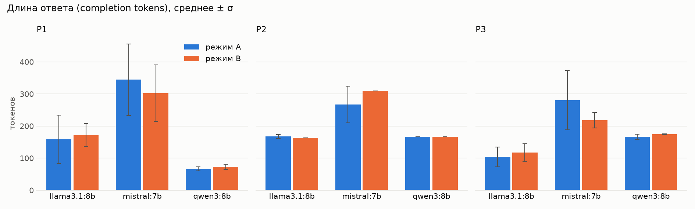
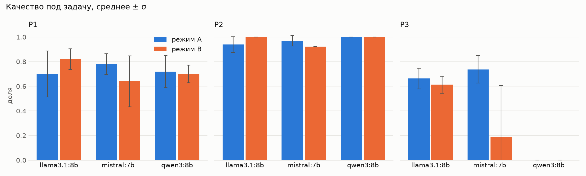
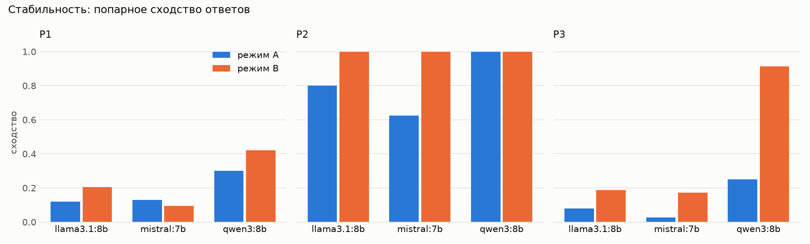
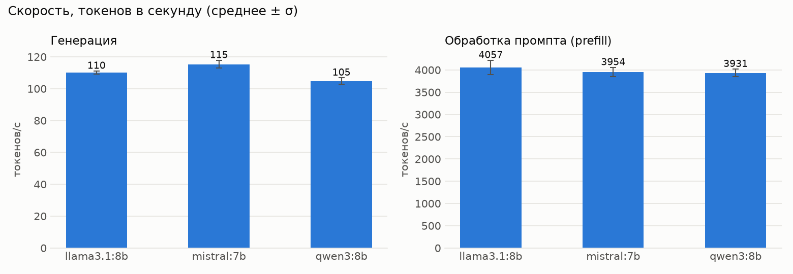

# Лабораторная работа №1. Развёртывание LLM и анализ гиперпараметров

## Описание задания

Локально развернуть три LLM из разных семейств, подготовить три запроса (генерация,
классификация и ещё один тип задачи), прогнать их в двух режимах — с параметрами по
умолчанию и с подобранными гиперпараметрами — и сравнить ответы по длине, качеству,
стабильности, галлюцинациям, времени отклика, числу токенов и скорости обработки промпта
и генерации.

## Стенд и модели

| | |
|---|---|
| Движок | Ollama 0.33.3, OpenAI-совместимый REST `http://localhost:11434/v1/chat/completions` |
| GPU | NVIDIA RTX 3090, 24 ГБ |
| Клиент | Python: `httpx`, стриминг с `stream_options.include_usage`; анализ — `pandas`, `matplotlib` |

Все модели в квантовании Q4_K_M:

| Семейство | Модель | Дефолты (режим A) |
|---|---|---|
| Qwen | `qwen3:8b` | из Modelfile: `temperature 0.6`, `top_p 0.95`, `top_k 20`, `repeat_penalty 1` |
| Llama | `llama3.1:8b` | дефолты Ollama: `temperature 0.8`, `top_p 0.9`, `top_k 40` |
| Mistral | `mistral:7b` | дефолты Ollama |

Особенности моделей, которые влияют на сравнение:

* **Qwen3 по умолчанию «думает».** Рассуждения идут в `completion_tokens` и раздувают время
  ответа, поэтому в обоих режимах ему передаётся `reasoning_effort: "none"`. Это
  отключение функции модели, а не тюнинг: варьируемые гиперпараметры у всех моделей одни и те же.
* **У Mistral нет отдельной system-роли.** Чат-шаблон Ollama вклеивает system-сообщение
  в последний блок `[INST]` перед текстом пользователя. Формально промпт тот же, но модель
  видит правила как часть запроса, а не как инструкцию верхнего уровня.
* **Через `/v1` Ollama применяет не все параметры:** `temperature`, `top_p`, `max_tokens`,
  `seed`, `frequency_penalty`, `presence_penalty` работают, а `top_k` и `repeat_penalty`
  игнорируются. Поэтому режим B собран только из параметров первой группы.

## Промпты

Каждый запрос состоит из двух сообщений: **system** — правила ответа (формат, допустимые
метки, запрет добавлять факты) и **user** — задача и данные. System одинаковый в обоих
режимах, так что A и B отличаются только гиперпараметрами.

| | Задача | Как оценивается |
|---|---|---|
| **P1** | генерация: вежливый отказ работодателю, 40–60 слов; причины — объём обязанностей и зарплата, про плохие отзывы о компании не упоминать | чеклист из 8 пунктов (обращение, компания, должность, отказ, обе причины, благодарность, подпись), запрет на «отзывы», объём |
| **P2** | классификация 13 обращений по меткам `Billing` / `Tech support` / `Sales` / `Unknown`; 3 обращения не по теме (IQ 175, Евангелие, «ненавижу Dota 2») | accuracy, валидность JSON, распознавание «не по теме» |
| **P3** | переформулирование: переписать токсичный комментарий против аниме вежливо, сохранив позицию автора, не длиннее исходного | 8 тезисов автора, запреты (мат, грубые слова, растянутые буквы, «!!», отказ, спор с автором), объём, капслок; мат или отказ → 0 |

Тексты — в `prompts/example/` и `prompts/system/`, эталоны — в `prompts/gold.json`.

## Режимы

* **A — базовый:** в запросе только `model` и `messages`, работают дефолты из таблицы выше.
* **B — тюнинг:** свой набор параметров на каждую задачу (`params_b` в `config.yaml`).

Наборы B подбирались по результатам A пробными прогонами `run.py trial` (3 повтора на
модель, в итоговые данные не входят):

| Задача | Цель | Что пробовали | Итоговый набор B |
|---|---|---|---|
| P1 | креативнее дефолтов, без обрывов | `t 1.0, top_p 0.95, presence 0.3, max 200` — у mistral все ответы оборвались на 200 токенах, качество 0.50 | `temperature 0.9, top_p 0.95, presence_penalty 0.3, max_tokens 600` |
| P2 | одинаковый ответ на каждом прогоне | — | `temperature 0, seed 42, max_tokens 400` |
| P3 | меньше выдумок и мусора | `t 0.3, top_p 0.85` против `t 0.8, frequency_penalty 0.5`: со штрафом у llama и mistral в ответы вернулись «дичь» и «отбросы», qwen3 не изменился | `temperature 0.3, top_p 0.85, max_tokens 500` |

`max_tokens` везде выбран с запасом относительно самого длинного ответа режима A (502
токена), чтобы обрыв не смешивался с эффектом температуры: в итоговых прогонах обрывов нет.

Каждая ячейка «модель × промпт × режим» прогнана **5 раз**, итого 90 прогонов
(`results/runs.jsonl`, в читаемом виде — `results/answers.md`).

## Результаты

### Длина ответа



Среднее число токенов ответа (в скобках - слов):

| Модель | P1 A → B | P2 A → B | P3 A → B |
|---|---|---|---|
| qwen3:8b | 66 → 73 (29 → 31) | 167 → 167 | 167 → 175 (67 → 66) |
| llama3.1:8b | 158 → 172 (81 → 82) | 167 → 163 | 104 → 117 (54 → 63) |
| mistral:7b | 344 → 302 (128 → 123) | 267 → 309 | 281 → 218 (101 → 75) |

* Требование 40–60 слов в P1 не выполнила ни одна модель ни в одном из 30 ответов: qwen3
  стабильно пишет 25–37 слов, llama — 24–137, mistral — 82–190. Гиперпараметры это не
  исправляют: температура меняет выбор слов, а не длину, а `max_tokens` только обрезает.
* В P2 длина задана форматом JSON и от режима почти не зависит.
* Mistral пишет больше всех во всех задачах и тратит больше токенов на то же число слов
  (см. «Скорость»).

### Качество



| Модель | P1 A → B | P2 A → B | P3 A → B (авто) | P3, ручная разметка: годно / частично из 5 |
|---|---|---|---|---|
| qwen3:8b | 0.72 → 0.70 | 1.00 → 1.00 | 0.00 → 0.00 | A 0/0 → B 0/0 |
| llama3.1:8b | 0.70 → 0.82 | 0.94 → 1.00 | 0.66 → 0.61 | A 0/2 → B 1/0 |
| mistral:7b | 0.78 → 0.64 | 0.97 → 0.92 | 0.74 → 0.19 | A 0/2 → B 0/4 |

**P1.** Креативный набор помог llama, меньше потерянных
пунктов чеклиста. Mistral при температуре 0.9 ухудшилась: в трёх ответах из пяти нет явного
отказа, а один ответ (и ещё один в пробных прогонах) написан целиком на английском — в нём
чеклист не находит ни обращения, ни причин. Qwen3 почти не изменилась: текст короткий и стабильно теряет подпись.

**P2.** Qwen3 безошибочна в обоих режимах. Llama в режиме A ошибалась на неоднозначных
обращениях (№13 «оплата не проходит, ошибка 502» → `Billing`) и один раз поставила `Sales`
обращению не по теме. При `temperature 0` все 5 ответов безошибочны. Mistral в режиме A
ошибалась на №6 («закрывающие документы и счёт-фактура» → `Tech support` вместо `Billing`)
в 2 прогонах из 5, а при `temperature 0` — во всех пяти. Детерминированный выбор
закрепляет самый вероятный токен, и для mistral это оказалась ошибка, а не большинство
из пяти случайных прогонов.

**P3** разобран отдельно ниже: автооценка по ключевым словам здесь вводит в заблуждение.

### Стабильность



Среднее попарное сходство пяти ответов (`difflib`), в скобках — число уникальных ответов:

| Модель | P1 A → B | P2 A → B | P3 A → B |
|---|---|---|---|
| qwen3:8b | 0.30 (5) → 0.42 (5) | 1.00 (1) → 1.00 (1) | 0.25 (5) → **0.91** (3) |
| llama3.1:8b | 0.12 (5) → 0.21 (5) | 0.80 (4) → **1.00** (1) | 0.08 (5) → 0.19 (5) |
| mistral:7b | 0.13 (5) → 0.09 (5) | 0.62 (2) → **1.00** (1) | 0.03 (5) → 0.17 (5) |

* `temperature 0` + `seed` в P2 дали полный детерминизм у всех трёх моделей: один и тот
  же ответ байт в байт.
* В P1 сходство и должно оставаться низким: высокая температура — это разные письма на каждом прогоне.
* В P3 при `temperature 0.3` qwen3 стала копировать исходник почти дословно (0.91).
* Qwen3 стабильнее остальных и в режиме A: её Modelfile задаёт более «узкие» дефолты
  (`temperature 0.6`, `top_k 20`) против `0.8 / 40` у Llama и Mistral. Часть «разницы между
  моделями» в режиме A — это разница в дефолтах.

### Галлюцинации

Автоматический детектор: числа в P1 и P3, которых нет в промпте; в P2 — метки вне списка
и реальные метки у обращений не по теме.

* **P1 и P3: выдуманных чисел нет** ни в одном из 60 ответов.
* **P2: один случай** — llama в режиме A поставила `Sales` обращению «У меня 175 IQ…».
  Меток вне списка нет, JSON валиден во всех 30 ответах.
* **Выдуманные утверждения без чисел** детектор не ловит. Ручная проверка P3 нашла их у
  llama («в аниме пропагандируются дружба, честность и ответственность») и mistral
  («аниме ведёт к распространению агрессии у детей»).

### Время и скорость



| Модель | Генерация, ток/с | Обработка промпта (prefill), ток/с | Токенов на один и тот же русский текст | Время ответа, с (P1 / P2 / P3, A) |
|---|---|---|---|---|
| qwen3:8b | 104.9 | 3931 | 2646 (0.97) | 0.65 / 1.61 / 1.66 |
| llama3.1:8b | 110.1 | 4057 | 2733 (1.00) | 1.45 / 1.55 / 1.01 |
| mistral:7b | 115.4 | 3954 | 4265 (1.56) | 2.96 / 2.33 / 2.50 |

* **Prefill измерен отдельно.** В основных прогонах промпт повторяется, и Ollama берёт его
  из KV-кеша: TTFT 0.01–0.08 с, скорость по нему не посчитать. Замер — три уникальных
  текста по 1500 русских слов с `max_tokens = 1`, одинаковых для всех моделей
  (`results/models.json`).
* **Токены разных моделей несопоставимы.** На одном и том же русском тексте Mistral тратит
  в 1.56 раза больше токенов, чем Llama: её словарь (~32k токенов) почти не покрывает
  кириллицу. Поэтому по токенам в секунду Mistral самая быстрая, а по реальному времени
  ответа самая медленная: слов в ответе больше, и каждое слово дороже.
* **Режим почти не влияет на скорость** (±3 ток/с). Время ответа определяется длиной
  ответа: у mistral в P3 ответ короче на 63 токена, и время упало с 2.50 до 2.03 с.

### P3: ручная разметка

Автооценка P3 проверяет ключевые слова и не видит главного: сохранена ли позиция автора
(он против аниме), переписан ли текст или модель отвечает автору, и есть ли выдумки.
Все 30 ответов размечены вручную — [results/p3_manual.md](results/p3_manual.md).

У каждой модели свой способ провалить задачу:

* **qwen3** переводит текст в нижний регистр и меняет одну фразу, но оставляет весь мат.
  Это не зависит ни от параметров, ни от версии system-промпта.
* **llama** чистит лексику вместе со смыслом. При `temperature 0.3` это стало
  систематическим: 4 ответа из 5 начинаются с «Я не согласен, что аниме — деградация
  общества». Автооценка ставит им около 0.6, потому что слова-тезисы в тексте есть.
* **mistral** в режиме A чаще меняет позицию или отвечает автору, а при низкой температуре
  держится ближе к исходнику: позиция сохранена во всех 5 ответах, но вместе с ней
  остаются «дичь» и «отбросы». Автооценка ставит этим ответам 0, хотя по смыслу они
  лучше ответов режима A.

## Выводы

1. **Эффект гиперпараметров зависит от модели, а не только от задачи.** Один и тот же
   креативный набор в P1 поднял llama с 0.70 до 0.82 и уронил mistral с 0.78 до 0.64.
2. **Низкая температура делает ответ стабильным, но не правильным.** В P2 `temperature 0`
   дала детерминизм у всех трёх моделей, исправила llama (0.94 → 1.00) и закрепила ошибку
   mistral на №6, которая в режиме A была в 2 прогонах из 5. В P3 при `temperature 0.3`
   qwen3 начала копировать исходник, а llama систематически менять позицию автора.
3. **Часть требований параметрами не решается.** Объём 40–60 слов не выдержала ни одна
   модель, детоксификацию с сохранением позиции не решила ни одна.
4. **По совокупности** для русскоязычных задач лучше всех qwen3 в структурных задачах
   (P2 — 1.00 в обоих режимах, самые короткие и быстрые ответы), llama — в генерации после
   тюнинга. Mistral слабее остальных на русском и чувствительнее к температуре.

## Запуск

```bash
ollama pull qwen3:8b && ollama pull llama3.1:8b && ollama pull mistral:7b
uv sync
uv run python run.py experiment --modes A
uv run python run.py experiment --modes B --no-prefill
uv run python run.py analyze
```
