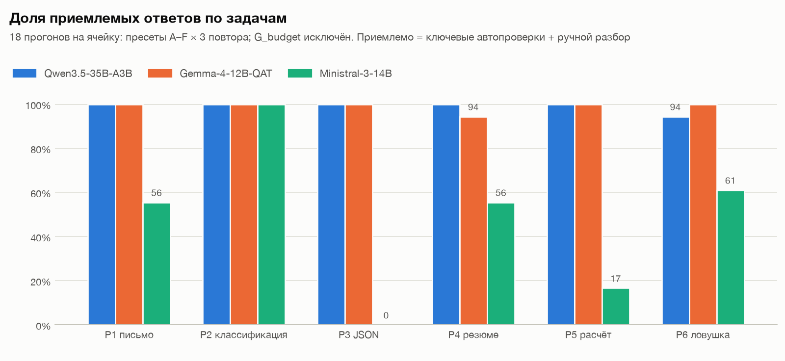
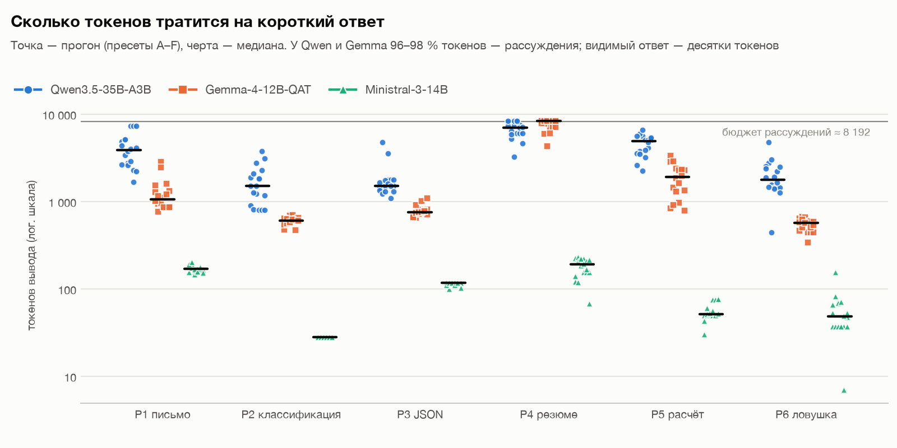
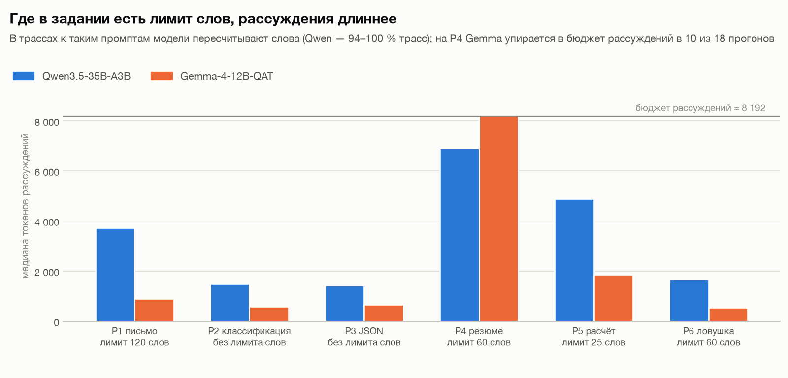
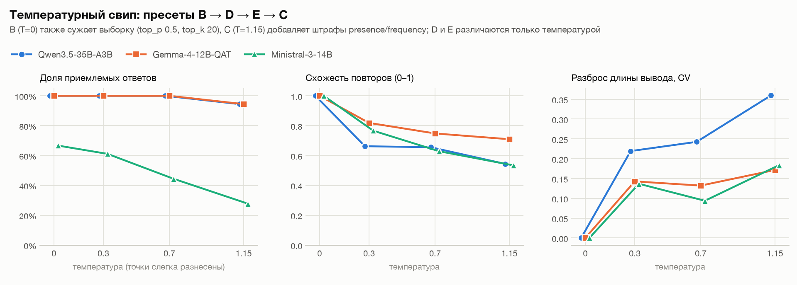
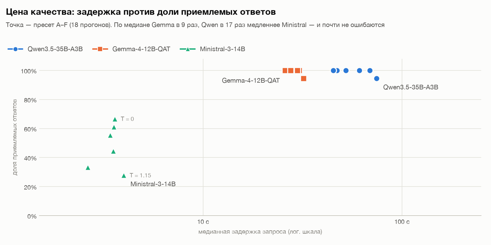

# Лабораторная работа №1 — Развёртывание и эмпирический анализ LLM

## Описание задания

Развернуть три LLM из разных семейств через OpenAI-совместимый REST API, подготовить
разнотипные тестовые запросы, прогнать каждый в базовом режиме (дефолты движка) и в режимах
с изменёнными гиперпараметрами, сохранить все прогоны и провести эмпирический анализ: длина
ответа, точность и адекватность, стабильность и детерминизм, повторяемость, фактические ошибки
и галлюцинации, время отклика и скорость генерации.

Сделано больше минимума: 6 промптов вместо 3, 7 режимов генерации вместо 2, по 3 повтора
на каждую конфигурацию — **378 прогонов** (3 модели × 6 × 7 × 3). Все ответы прочитаны вручную.

## Использованные технологии и модели

**Среда инференса:** [LM Studio](https://lmstudio.ai/), локальный сервер
`http://localhost:1234/v1` — OpenAI-совместимый REST (`/v1/models`, `/v1/chat/completions`,
SSE-стриминг). Дополнительно — native-эндпоинт `/api/v0/models` со статусом загрузки модели.

| Модель | Семейство | Архитектура | Рассуждения в прогонах |
| --- | --- | --- | --- |
| `qwen3.5-35b-a3b` | Qwen (Alibaba) | MoE: 35B всего, ~3B активных | да, отдельным полем `reasoning_content` |
| `google/gemma-4-12b-qat` | Gemma (Google) | плотная 12B, quantization-aware training | да, отдельным полем `reasoning_content` |
| `mistralai/ministral-3-14b-reasoning` | Mistral | плотная 14B, reasoning-вариант | **нет ни в одном из 126 прогонов** (см. «Выводы») |

Квантизация — как скачано в LM Studio; в метаданных прогонов она не фиксировалась.

**Библиотеки:** Python 3.11+, `requests`; `matplotlib` — только для графиков; стандартные
`difflib`, `statistics`, `json`, `unittest`.

## Методика эксперимента

### Тестовые запросы

Все промпты на русском, ответ короткий (≤ 120 слов), но в каждом есть ловушка.
Полные тексты — [source/llm_lab/experiment/prompts.py](source/llm_lab/experiment/prompts.py).

| ID | Тип задачи | Что проверяет | Заложенная ловушка |
| --- | --- | --- | --- |
| P1 | генерация | Письмо-отказ подрядчику с 6 обязательными условиями | Запрет придумывать суммы, штрафы и фамилии |
| P2 | классификация | 6 обращений по меткам `Billing / Tech support / Sales / Other` | №4 и №6 спорные, есть правило разрешения конфликта |
| P3 | извлечение | 10 полей карточки товара в JSON | `warranty_months` и `price_rub` в тексте нет — обязателен `null` |
| P4 | суммаризация | Резюме инцидента тремя пунктами ≤ 60 слов | Все числа — только из исходника |
| P5 | многошаговый расчёт | Тариф доставки, верный ответ — 1431 ₽ | Округление 23,4 → 24 кг, скидка на всю сумму |
| P6 | ловушка на галлюцинации | Несуществующий ФЗ № 512-ФЗ, статья 14.7 | Правильно — признать, что документа нет |

### Режимы генерации

`A_baseline` отправляет только `model` и `messages`. Остальные режимы меняют от 3 до 5
гиперпараметров. **Лимит `max_tokens` есть только в `G_budget`**: у рассуждающих моделей он
расходуется на рассуждения и обрезает ответ до пустоты — это отдельный эксперимент.

| Ключ | Параметры | Зачем |
| --- | --- | --- |
| `A_baseline` | — | Дефолты движка |
| `B_precise` | `temperature=0.0, top_p=0.5, top_k=20, repeat_penalty=1.05` | Максимальный детерминизм |
| `C_creative` | `temperature=1.15, top_p=0.97, top_k=100, presence_penalty=0.6, frequency_penalty=0.3` | Высокая энтропия |
| `D_balanced` | `temperature=0.3, top_p=0.9, top_k=40` | Рабочая точка |
| `E_warm` | `temperature=0.7, top_p=0.9, top_k=40` | Точка свипа; от D отличается только температурой |
| `F_min_p` | `temperature=0.8, min_p=0.1, top_p=1.0, repeat_penalty=1.15` | Отсечение по `min_p` вместо `top_p` |
| `G_budget` | `temperature=0.2, top_p=0.9, max_tokens=256` | Эффект обрезки |

`B → D → E → C` — свип по температуре 0 / 0.3 / 0.7 / 1.15.

### Как оценивалось качество

1. **Автопроверки** ([source/llm_lab/evaluation/checks.py](source/llm_lab/evaluation/checks.py)) — балл в `[0; 1]` на каждый ответ:
   точность меток, совпадение всех полей JSON, верность итога, отсутствие чисел не из исходника,
   признание несуществующего документа, смешение языков, лимит длины и формат.
2. **Ручной разбор всех 378 ответов.** Проблемы, которые проверки не ловят (смысловые искажения,
   планы, поданные как выполненные, несвязность), записаны в
   [results/manual_review.json](results/manual_review.json) с цитатами и уровнем серьёзности.
3. **Главная метрика — доля приемлемых ответов:** ответ не пуст, пройдены ключевые для задачи
   проверки ([source/llm_lab/reporting/analysis.py](source/llm_lab/reporting/analysis.py), `KEY_CHECKS`) и в нём нет критической
   проблемы из ручного разбора. Средний балл приводится рядом, но он смешивает суть с формой.

### Измеряемые метрики производительности

- `completion_tokens` / `prompt_tokens` — из поля `usage` сервера.
- Разделение вывода на рассуждения и видимый ответ — оценка: токены ответа ≈ символы / 3.
  Оценка согласуется с таймингом: доля времени до начала ответа совпала с долей токенов
  рассуждений с точностью 93–100 % на всех 216 прогонах с рассуждениями.
- **TTFT** — время до первого токена любого вида; **до ответа** — до первого токена видимого
  ответа (у рассуждающей модели ≈ время рассуждений).
- **ток/с** — токены вывода за время декодирования (см. ниже про исправление расчёта).

## Результаты работы

### Сводка



108 прогонов на модель (пресеты A–F; `G_budget` рассмотрен отдельно):

| Модель | Приемлемо | Балл v2 | Задержка, медиана | Ток/с | Токенов вывода, ср. | Из них рассуждения | Время на 126 прогонов |
| --- | --- | --- | --- | --- | --- | --- | --- |
| Qwen3.5-35B-A3B | **99 %** (107/108) | 0.989 | 56 с | **56** | 3 466 | 98 % | 2.0 ч |
| Gemma-4-12B-QAT | **99 %** (107/108) | 0.999 | 29 с | 29 | 2 105 | 96 % | 2.3 ч |
| Ministral-3-14B | 48 % (52/108) | 0.861 | **3.3 с** | 28 | 100 | 0 % | **8 мин** |

| Модель | P1 письмо | P2 классификация | P3 JSON | P4 резюме | P5 расчёт | P6 ловушка |
| --- | --- | --- | --- | --- | --- | --- |
| Qwen3.5-35B-A3B | 100 % | 100 % | 100 % | 100 % | 100 % | 94 % |
| Gemma-4-12B-QAT | 100 % | 100 % | 100 % | 94 % | 100 % | 100 % |
| Ministral-3-14B | 56 % | 100 % | 0 % | 56 % | 17 % | 61 % |

Полные таблицы — [results/analysis.md](results/analysis.md); сравнение моделей —
[results/comparison.md](results/comparison.md); отчёты по моделям —
`results/<модель>/report.md`; каждый ответ с промптом и параметрами — `results/<модель>/answers/`.

### Разбор по задачам

**P1, письмо-отказ.** Qwen и Gemma выполнили все шесть условий во всех прогонах. Gemma пишет
шаблонно и одинаково («Уважаемые партнеры! Настоящим письмом уведомляем…»), Qwen разнообразнее.
При T = 1.15 у Qwen появляются грамматические сбои («Будем рады к обсуждению»). У Ministral
**фактическая ошибка в 3 из 18 писем**: «в общей сложности 21 день» при двух просрочках
по 11 дней — выдуманная и неверная сумма. При T ≥ 0.7 — вставки на английском: «что negatively
отразилось», «wish удачи», «hopefully продолжим». Во всех письмах Ministral — markdown-разметка,
в четырёх — заголовок «**Деловое письмо-отказ**» из текста задания.

**P2, классификация.** Все три модели верно разметили все 6 обращений, включая спорные, во всех
прогонах без лимита длины. Задача не различила модели (эффект потолка) и показала другое:
у Qwen и Gemma видимый ответ идентичен при любой температуре, а меняется только длина
рассуждений (у Qwen от 795 до 3 786 токенов). Ministral тратит 28 токенов и ~1 с, но при T = 0
сбивается с формата «1:» на «1.».

**P3, извлечение в JSON.** Qwen и Gemma безупречны: все 10 полей верны, `null` на месте
отсутствующих гарантии и цены — ни одной выдумки. Ministral **ни разу не выполнил** требование
«ТОЛЬКО JSON без markdown-обёртки» — все 21 ответ обёрнуты в блок кода `` ```json `` (прямой `json.loads` на них
падает). При T ≥ 0.7 модель **теряет данные, которые есть в тексте**: `"article": null`
в 4 прогонах, `"manufacturer": null` — в 2, транслитерация «TERMA-K3». Выдумывания нет —
есть потери.

**P4, резюме инцидента.** Qwen и Gemma точны: ни одного числа вне исходника. Gemma однажды
(T = 1.15) исказила смысл: «Из 3 204 платежей 2 870 повторены» — пропало «не прошло».
У Ministral — самые серьёзные смысловые ошибки эксперимента:
- **инверсия ключевого факта** (T = 1.15): «Прошло 3 204 платежа» вместо «не прошло»;
- **планы поданы как выполненные**: «проведено учение по переключению реплики до конца февраля»,
  «внесены изменения в конфигурацию» — в исходнике это только решения;
- **искажение причины**: «Первопричиной стало ошибочное плановое переключение реплики»;
- при T = 0 из резюме выпадают все принятые меры; в 11 из 21 прогона превышен лимит 60 слов
  (83–97 слов).

**P5, расчёт.** Самый показательный промпт. Qwen и Gemma дали верный итог 1431 ₽ **во всех
36 прогонах**. Ministral — только в 3 из 18 (все при T = 0). Остальные ответы разбросаны: 1395,
1398, 1377, 1392, 1308, 1215, 972, 738 и даже «5×450 + 19×60 = 8740». Часто итог не следует
из расчёта, который модель сама же привела («Расчёт: первые 5 кг — 450 ₽, 18 полных кг
по 60 ₽, скидка 10 %. Итого: 1395 ₽.»).

**P6, ловушка.** Qwen и Gemma отказались пересказывать несуществующий закон во всех завершившихся
прогонах без лимита. Gemma формулирует откалиброваннее всех («Я не располагаю данными о…»),
Qwen — слишком уверенно («отсутствует в реестре законодательства РФ»: реестр модель проверить
не может). Ministral при T ≤ 0.3 отказывается корректно, при T ≥ 0.7 выдумывает:
- «**Статья 14.7 определяет** обязательность создания цифровых двойников промышленных объектов…
  Требования распространяются на: Юридические лица; Индивидуальных предпринимателей (ИП)»;
- «**Ключевые положения:** 1. Обязанность создания… digital twin (ДТ)…»;
- «сам закон с таким номером отсутствует (**действующий — № 209-ФЗ от 2018 года**)»;
- «сам закон **называется «О цифровых technological»**».

### Длина ответов и разброс токенов



- **Видимый ответ у всех трёх моделей — десятки–сотни токенов** (медиана 24–190). У Qwen
  и Gemma 96–98 % токенов вывода — рассуждения: на письмо из 70 слов Qwen тратит медианно 3 700 токенов
  рассуждений, на резюме из 60 слов — 6 900.
- **Разброс длины почти целиком из рассуждений.** В P2 и P3 видимый ответ Qwen идентичен во всех
  18 прогонах, а длина вывода меняется в 4.4–4.8 раза.
- **Длина вывода Gemma предсказуемее:** в 4 задачах из 6 (P2, P3, P4, P6) коэффициент вариации
  между повторами у Gemma 0.07–0.10 против 0.16–0.24 у Qwen; в температурном свипе при T > 0 —
  0.13–0.17 против 0.22–0.36. На P1 и P5 разброс у моделей сопоставим.
- **Бюджет рассуждений LM Studio ≈ 8 192 токена.** На P4 Gemma упирается в него в 10 прогонах
  из 18, Qwen — в 4. Рассуждения обрываются фразой «I have to answer now.», после чего модель
  выдаёт ответ. Именно эти прогоны дают хвост задержки Gemma: до 302 с на резюме из 60 слов.



Если в задании есть лимит в словах, модели **пересчитывают слова в рассуждениях** — вплоть
до пословного перечисления («1-В 2-03:12 3-(14 4-января)…»). У Qwen такой подсчёт есть
в 94–100 % трасс для P1, P4, P5, P6 и в 0 % для P2 и P3, где лимита нет. На P1, P4 и P5
рассуждения в 2.6–4.8 раза длиннее, чем на P2 и P3; на P6 — почти столько же (ответ — короткий
отказ). Это корреляция на 6 промптах, а не контролируемый эксперимент: P4 и P5 сложнее P2 и P3
и сами по себе. Но обрывы на P4 приходятся именно на пересчёт слов.

### Влияние гиперпараметров



| Модель | Приемлемо при T = 0 / 0.3 / 0.7 / 1.15 | Схожесть повторов T = 0 → 1.15 | Базовый | `F_min_p` (T = 0.8) | `G_budget` |
| --- | --- | --- | --- | --- | --- |
| Qwen3.5-35B-A3B | 100 / 100 / 100 / 94 % | 1.00 → 0.54 | 100 % | 100 % | 0 % (18/18 пустых) |
| Gemma-4-12B-QAT | 100 / 100 / 100 / 94 % | 1.00 → 0.71 | 100 % | 100 % | 0 % (18/18 пустых) |
| Ministral-3-14B | 67 / 61 / 44 / 28 % | 1.00 → 0.53 | 56 % | 33 % | 67 % |

- **Температура.** Рассуждающие модели устойчивы к ней: до T = 0.7 качество 100 %, при 1.15 —
  по одному неприемлемому ответу (у Qwen — обрыв потока на стороне сервера, у Gemma — искажение
  факта). Рост температуры меняет путь рассуждений, но не итог: в классификации и JSON
  видимые ответы совпадают при любой T. У Ministral качество падает монотонно, с 67 % до 28 %:
  растут ошибки в расчётах, выдумки в P6, потери полей в P3 и вставки на английском.
- **Детерминизм.** При T = 0 все три модели выдают побайтно идентичные ответы и **идентичное
  число токенов** во всех 18 ячейках — даже MoE-модель Qwen при 7 290 токенах вывода.
  В однопоточном режиме LM Studio жадное декодирование полностью воспроизводимо.
- **Базовый режим (дефолты LM Studio)** у Qwen и Gemma по качеству не отличается от тюнинга,
  но повторы расходятся сильно (схожесть 0.64 и 0.68) — дефолтная температура высокая.
  У Ministral базовые повторы почти совпадают (схожесть 0.955): дефолт этой модели ведёт себя
  как низкая температура.
- **T = 0 не всегда быстрее.** В P1 жадное декодирование вдвое удлинило рассуждения Qwen:
  7 290 токенов и 130 с против 2 600–3 800 токенов в базовом режиме; в остальных задачах T = 0
  не длиннее базового. Зацикливания нет (доля повторяющихся 8-грамм ≤ 1.6 %) — это перепроверки.
- **`min_p` + `repeat_penalty 1.15`** не дали выигрыша ни одной модели, а у Ministral режим
  хуже соседней T = 0.7 (33 % против 44 %; например, «5×450 + 19×60 = 8740»).
- **`max_tokens = 256` для рассуждающих моделей бесполезен:** все 36 ответов Qwen и Gemma пустые —
  256 токенов уходят на первые строки рассуждений. На Ministral лимит не повлиял: его ответы короче.

### Производительность



| Модель | Ток. ввода | Ток/с | Задержка: медиана / p95 | До начала ответа, ср. | Доля времени на рассуждения |
| --- | --- | --- | --- | --- | --- |
| Qwen3.5-35B-A3B | ~250 | **56** | 56 / 132 с | 64 с | 97 % |
| Gemma-4-12B-QAT | ~250 | 29 | 29 / 300 с | 72 с | 93 % |
| Ministral-3-14B | ~265 | 28 | **3.3 / 7.7 с** | 0.1 с | — |

- **MoE декодирует вдвое быстрее плотных моделей:** у Qwen 35B, но активны ~3B, отсюда 56 ток/с
  против 28–29 у плотных 12B и 14B. Однако Qwen рассуждает в 1.6 раза многословнее Gemma, и по
  медианной задержке (56 против 29 с) выигрыш в скорости съедается.
- **Цена рассуждений:** Gemma в 9 раз, Qwen в 17 раз медленнее Ministral по медиане. Весь
  эксперимент занял 2.0 ч (Qwen), 2.3 ч (Gemma) и 8 минут (Ministral). Практически всё время
  рассуждающих моделей уходит на рассуждения: видимый ответ начинается на 93–97 % времени запроса.
- Промпт короткий (~250 токенов), поэтому prefill пренебрежимо мал на фоне генерации.

### Исправления в процессе работы

**Скорость генерации (тысячи ток/с).** TTFT засекался по первому токену поля `content`. LM Studio
отдаёт рассуждения Qwen и Gemma отдельным полем `reasoning_content`, поэтому засекалось время до
начала **ответа** (95–97 % запроса). Все токены делились на короткий хвост генерации ответа —
медиана получалась 1 755 ток/с у Qwen и 417 у Gemma. Исправлено без перепрогона:
- клиент теперь засекает TTFT по первому токену любого вида, а время до ответа — отдельно;
- команда `recompute-metrics` ([recompute_metrics.py](source/llm_lab/maintenance/recompute_metrics.py))
  пересчитала сохранённые прогоны:
  старое значение перенесено в «до ответа», скорость = токены / полное время. Итог — 56 и 29
  ток/с, что совпадает с наблюдаемым в LM Studio. Ответы, токены и задержки не изменились —
  сверено побайтно с резервной копией;
- `runs.jsonl` уменьшились почти вдвое: убраны дубли текста ответа внутри `metrics`.

**Склейка прогонов Gemma.** Gemma запускалась тремя сессиями (P1–P4, P5, P6); без `--append`
каждый запуск перезаписывал `answers/` и `manifest.json`. Команда `merge`
([merge_runs.py](source/llm_lab/maintenance/merge_runs.py)) собрала 126 прогонов в один `runs.jsonl`, пересобрал `answers/` и восстановил манифест с историей
сессий. Первая сессия оборвалась после `P5/A_baseline/r1`; эта запись заменена полным набором P5
из второй сессии, чтобы повторы одной конфигурации шли из одного запуска. Отброшенная запись
сохранена в манифесте.

**Автопроверки v1 → v2.** Ручной разбор показал ошибки самих проверок. Исправлены и пересчитаны
по сохранённым ответам (команда `rescore`, [rescore.py](source/llm_lab/maintenance/rescore.py)); старые баллы остались в записях
как `quality_score_v1`:

| Ошибка v1 | Пример | Последствие |
| --- | --- | --- |
| Словоформы | «пусконаладочном» не содержит «пусконаладк» | Qwen: 2 ложных провала в P1 |
| Слишком узкий маркер | «Исчерпание пула (лимит 40 вместо 400)» — не найдено «пул соединен» | Qwen: 6 ложных провалов в P4 |
| Маркер выдумки в честном отказе | «изложить положения статьи 14.7 невозможно» | Qwen: 2 ложных провала в P6 |
| Слово-заголовок как содержание | «Принятые **меры**:» при отсутствии мер | Ministral: 4 пропущенных провала |
| Склейка чисел | «03:12 14 января» → 1214 | Ministral: 1 ложная галлюцинация |
| Частичная сверка JSON | проверялись только артикул и IP | Ministral: `manufacturer: null` не замечен |
| Нет проверки обёртки, языка, полярности, чисел в письме | `` ```json ``, «negatively», «Прошло 3 204», «21 день» | Ministral: 34 пропущенных провала |
| Пустой ответ набирал баллы | «нет выдуманных чисел» тривиально верно для пустой строки | Qwen/Gemma: 0.23–0.33 за пустой ответ |

Все исправления закреплены регрессионными тестами на реальных ответах
([test_checks_regression.py](source/tests/test_checks_regression.py)). Каждое новое срабатывание v2 проверено
вручную — ложных нет.

## Выводы

**О моделях**

1. **Qwen3.5-35B-A3B и Gemma-4-12B-QAT — надёжные модели для всех шести задач:** по 99 %
   приемлемых ответов, ни одного выдуманного факта в P3 и P6 и ни одной ошибки в расчёте.
   Цена — десятки секунд и тысячи токенов рассуждений на ответ из десятков слов.
2. **Gemma — лучший баланс:** меньше рассуждений (в среднем 2 000 против 3 400 токенов), вдвое ниже
   медианная задержка, самые осторожные отказы в P6 и стабильная длина вывода. Слабое место —
   длинный хвост задержки на P4, где модель упирается в бюджет рассуждений.
3. **Qwen декодирует вдвое быстрее** благодаря MoE, но многословные рассуждения и самый большой
   разброс длины делают его задержку наименее предсказуемой.
4. **Ministral-3-14B в этом эксперименте работал без рассуждений** и фактически стал контрольной
   нерассуждающей моделью близкого размера. Разница с рассуждающими моделями — главный результат
   работы: 17 % против 100 % на многошаговом расчёте, выдумки при T ≥ 0.7, потеря данных в JSON,
   инверсия фактов в резюме, смешение языков. При этом Ministral в 9–17 раз быстрее и безупречен
   на простой классификации (100 % за ~1 с).
   Вероятная причина отсутствия рассуждений — наш system prompt заменил штатный системный промпт
   модели, который включает режим рассуждений у reasoning-вариантов Mistral.

**О гиперпараметрах**

5. **Для рассуждающих моделей температура влияет на путь, а не на итог:** до T = 0.7 качество не
   меняется, при 1.15 — единичные сбои. Для нерассуждающей модели температура — главный рычаг
   качества: лучший результат при T = 0 и монотонное падение с её ростом.
6. **T = 0 даёт полную воспроизводимость** в LM Studio (идентичны и тексты, и число токенов)
   без потери качества. Для классификации и извлечения это разумный выбор по умолчанию.
7. **Жёсткий `max_tokens` несовместим с рассуждающими моделями:** 256 токенов обнулили все 36
   ответов. Лимит, если он нужен, должен покрывать рассуждения — у LM Studio это ~8 192 токена
   плюс ответ.
8. **Лимит в словах в промпте дорог для рассуждающих моделей:** модели пересчитывают слова
   в рассуждениях, на P4 это доходит до бюджета. Мягкие формулировки («2–3 предложения»)
   или ограничение формата, вероятно, дешевле — это стоит проверить отдельно.
9. **`min_p` и `repeat_penalty 1.15`** не улучшили ни одну модель; `presence/frequency_penalty`
   в пресете C не предотвратили падения качества Ministral.

**Об оценке**

10. **Автопроверки без ручного разбора вводят в заблуждение.** По первой версии Ministral
    выглядел лучшей моделью (балл 0.897 против 0.852 у Qwen): проверки не видели обёртку JSON,
    вставки на английском и инверсию фактов, а у Qwen засчитывали провалы на словоформах.
    Средний балл ещё и сглаживает разницу (0.861 против 0.989), поэтому основной метрикой
    выбрана доля приемлемых ответов.

**Ограничения**

- 3 повтора на ячейку: доля в ячейке из 18 прогонов меняется с шагом 5.6 п. п., различия
  в 1–2 прогона — в пределах шума.
- Проверки v2 уточнялись после чтения ответов. Риск «подгонки» снижен: v1-баллы сохранены,
  изменения либо исправляют очевидные ложные результаты, либо проверяют явные требования промпта,
  а критические проблемы ручного разбора вынесены в отдельный файл с цитатами.
- Разделение токенов на рассуждения и ответ — оценка. Для прогонов с рассуждениями до исправления
  истинный TTFT неизвестен, поэтому скорость считается по полному времени запроса (prefill
  ~250 токенов пренебрежимо мал).
- Дефолтные параметры базового режима задаются пресетами LM Studio для каждой модели и в прогонах
  не фиксировались.
- Один сбой сервера на 378 прогонов: у Qwen (`P6/C_creative/r3`) поток оборвался без
  `finish_reason` после 445 токенов рассуждений.

## Структура проекта

Весь код запускается через одну точку входа `source/main.py`, а модули разложены по назначению.
Список команд — `python source/main.py`, справка по команде — `python source/main.py <команда> --help`.

```sh
lab1/
├── README.md                          # этот отчёт
├── source/
│   ├── main.py                        # точка входа: run, compare, analyze, plots, merge, recompute-metrics, rescore, test
│   ├── requirements.txt
│   ├── llm_lab/
│   │   ├── paths.py                   # где лежат source/, results/, tests/
│   │   ├── storage.py                 # чтение и запись results/<модель>/: runs.jsonl, карточки, манифест
│   │   ├── evaluation/                # КАК оцениваем ответы
│   │   │   ├── text.py                #   разбор ответов: <think>, JSON, числа, схожесть
│   │   │   └── checks.py              #   автопроверки, детекторы галлюцинаций и смешения языков
│   │   ├── inference/                 # КАК общаемся с сервером
│   │   │   ├── params.py              #   адрес API и гиперпараметры запроса
│   │   │   ├── client.py              #   OpenAI-совместимый клиент: стриминг, TTFT, время до ответа, usage
│   │   │   ├── speed.py               #   формула скорости и оценка токенов рассуждений
│   │   │   └── mock.py                #   оффлайн-бэкенд для run --self-test
│   │   ├── experiment/                # ЧТО запускаем
│   │   │   ├── config.py              #   пресеты гиперпараметров и профили
│   │   │   ├── prompts.py             #   6 тестовых промптов и их автопроверки
│   │   │   └── runner.py              #   цикл промпт × пресет × повтор
│   │   ├── reporting/                 # ЧТО показываем
│   │   │   ├── markdown.py            #   форматирование чисел и таблиц
│   │   │   ├── stats.py               #   агрегация метрик по прогонам
│   │   │   ├── model_report.py        #   отчёт по модели → results/<модель>/report.md
│   │   │   ├── comparison.py          #   сравнение моделей → results/comparison.md
│   │   │   ├── analysis.py            #   сводный анализ → results/analysis.md, analysis.json
│   │   │   └── plots.py               #   графики → results/figures/
│   │   ├── maintenance/               # обслуживание сохранённых результатов без перепрогона
│   │   │   ├── merge_runs.py          #   склейка прогонов из нескольких сессий
│   │   │   ├── recompute_metrics.py   #   пересчёт метрик скорости
│   │   │   └── rescore.py             #   пересчёт автопроверок
│   │   └── commands/                  # команды CLI: разбор аргументов и вывод, по модулю на команду
│   │       └── run.py, compare.py, analyze.py, plots.py, merge.py, recompute_metrics.py, rescore.py
│   └── tests/                         # 77 тестов по тем же областям, без сети и модели
│       ├── test_evaluation.py, test_inference.py, test_experiment.py
│       ├── test_checks_regression.py  #   регрессия проверок на реальных ответах моделей
│       ├── test_reporting.py, test_storage.py, test_maintenance.py
│       └── fixtures.py
└── results/
    ├── analysis.md, analysis.json     # сводные таблицы анализа
    ├── comparison.md                  # сравнение моделей
    ├── manual_review.json             # итоги ручного разбора ответов
    ├── figures/                       # графики для отчёта
    └── <модель>/
        ├── manifest.json              # параметры запуска (для Gemma — история 3 сессий)
        ├── runs.jsonl                 # все прогоны: промпт + параметры + ответ + рассуждения + метрики
        ├── answers/                   # 126 карточек: промпт, параметры, ответ, метрики, проверки
        └── report.md                  # отчёт по модели
```

Пакеты в `llm_lab/` перечислены по слоям: каждый импортирует только пакеты выше себя
(`evaluation` ни от чего не зависит, `commands` зависит от всех, а от `commands` — никто).
Логику можно использовать и тестировать без командной строки.

## Инструкция по запуску

### 1. Подготовка

```bash
pip install -r source/requirements.txt
```

В LM Studio включить локальный сервер (Developer → Start Server, порт 1234) и загрузить
**одну** модель. Проверить доступность:

```bash
python source/main.py run --list-models
```

### 2. Прогон модели

```bash
python source/main.py run --model qwen3.5-35b-a3b --profile full --repeats 3 --stream
```

Если прогон модели разбит на несколько запусков, добавляйте `--append`: без него каждый запуск
перезаписывает `answers/`, `manifest.json` и `report.md` модели.

```bash
python source/main.py run --model google/gemma-4-12b-qat --profile full --repeats 3 --stream --prompts P5 P6 --append
```

### 3. Анализ

```bash
python source/main.py compare
python source/main.py analyze
python source/main.py plots
```
### 5. Проверка гипотезы о рассуждениях Ministral

Один прогон P5 без system prompt: если в `results/<модель>/answers/P5__B_precise__r1.md` появится
блок рассуждений, гипотеза подтверждена. Запуск в отдельную директорию, чтобы не перезаписать
основные результаты:

```bash
python source/main.py run --model mistralai/ministral-3-14b-reasoning --prompts P5 --presets B_precise --repeats 1 --stream --no-system-prompt --results results_nosys
```

### 6. Полезные флаги

| Флаг | Назначение |
| --- | --- |
| `--profile min/core/sweep/full` | 2 / 4 / 5 / 7 пресетов |
| `--presets B_precise C_creative`, `--prompts P1 P3` | подмножество пресетов и промптов |
| `--repeats N` | повторов на конфигурацию |
| `--stream` | SSE-стриминг: TTFT и время до ответа |
| `--append` | дописать к существующим результатам |
| `--budget-max-tokens N` | лимит длины в `G_budget` (по умолчанию 256) |
| `--safety-max-tokens N` | страховочный лимит для остальных пресетов (по умолчанию выключен) |
| `--no-system-prompt` | не отправлять system prompt |
| `--no-extra-params` | не отправлять `top_k` / `repeat_penalty` / `min_p` |
| `--base-url URL` | другой сервер: vLLM, SGLang, Ollama |
| `--report-only` | пересобрать отчёт модели из `runs.jsonl` |
| `--self-test` | прогон пайплайна на мок-бэкенде |

### 7. Тесты

```bash
python source/main.py test -v
```
