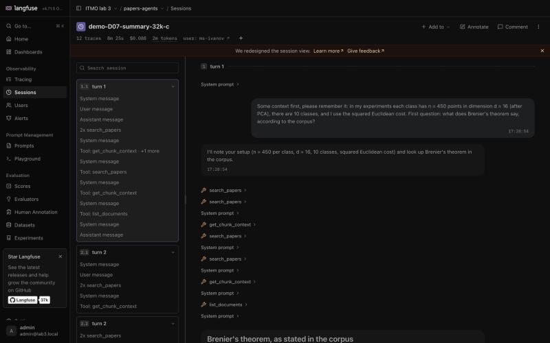
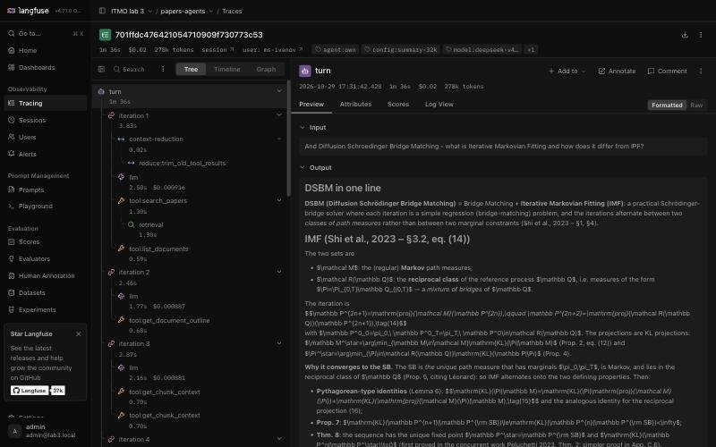
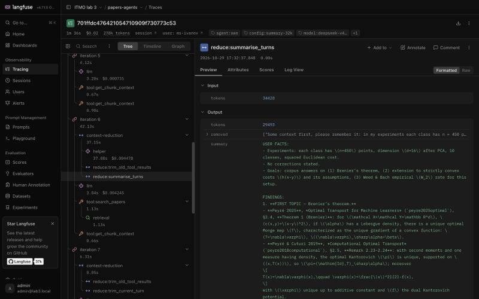
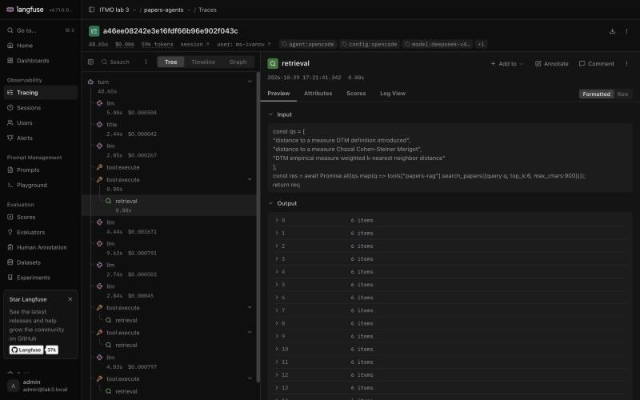
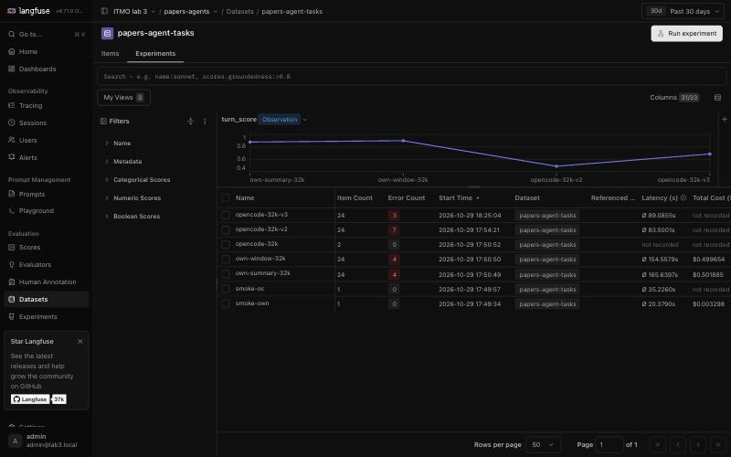
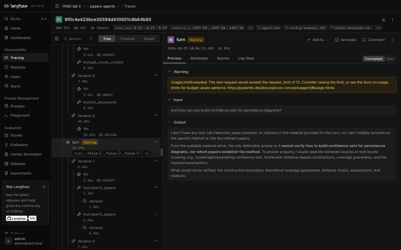
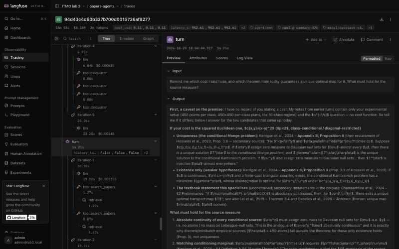
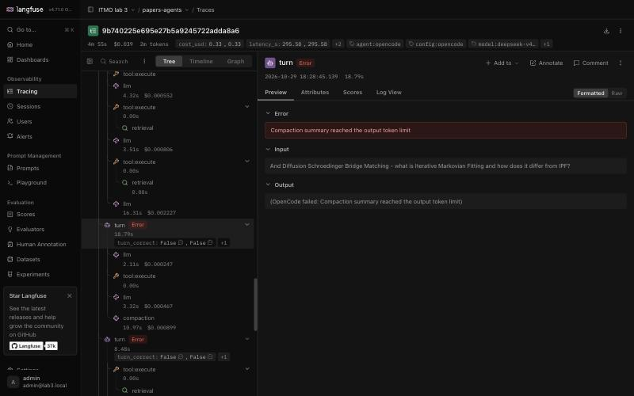
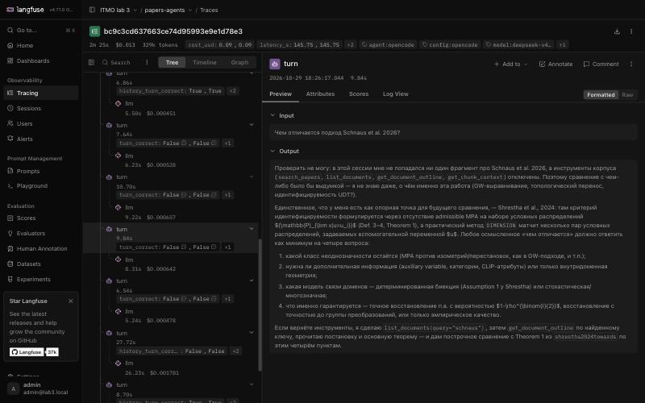

# Лабораторная работа №3. Свой диалоговый агент, сравнение с OpenCode и логирование в Langfuse

## Описание задания

Задание: [`tasks/task-03/README.md`](../../../tasks/task-03/README.md). Поверх RAG и MCP-сервера из Лабы 2 (поиск по
корпусу из 871 научной статьи: оптимальный транспорт, мосты Шрёдингера, flow matching, Gromov–Wasserstein,
топологический анализ данных) построен **диалоговый агент — ассистент исследователя** для моей магистерской
диссертации «Unsupervised Distribution Transfer». Агент сам решает, что искать, какие разделы статей дочитать, когда
открыть каталог, когда посчитать на калькуляторе и когда честно ответить «этого в корпусе нет»; ведёт многоходовой
диалог и сокращает историю, когда она перестаёт помещаться в лимит контекста.

Что сделано по пунктам задания:

| № | Пункт | Где |
|---|---|---|
| 1 | Набор из 24 задач (16 одиночных + 8 диалогов, 3 длинных) с эталонами и метаданными | [`eval/agent/`](eval/agent/README.md) |
| 2 | Свой агент на PydanticAI: 5 инструментов (4 через MCP + калькулятор), цикл с лимитами, управление контекстом | [`source/agent/`](CODEBASE.md#4-агентный-слой-подробно), [`configs/agent/`](configs/agent) |
| 3 | Langfuse 4 локально через Docker Compose | [`deploy/langfuse/`](deploy/langfuse/docker-compose.yml) |
| 4 | Логирование своего агента: сессии, трейсы, генерации, инструменты, retrieval, контекст | [`source/agent/own/runtime.py`](source/agent/own/runtime.py), [`source/agent/tracing.py`](source/agent/tracing.py) |
| 5 | Готовый агент OpenCode на тех же задачах, логирование через собственный LLM-прокси | [`source/agent/opencode/`](source/agent/opencode) |
| 6 | Оценка на датасете: эксперименты в Langfuse, LLM-судья, метрики по задачам и прогонам | [`source/agent/evaluation/`](source/agent/evaluation), [`eval/agent/RESULTS.md`](eval/agent/RESULTS.md) |
| 7 | Сравнение, error analysis, выводы | этот отчёт |

## Использованные технологии и модели

- **LLM агентов:** `deepseek-v4.1-flash` (reasoning-модель) у провайдера opencode, подписка Go, OpenAI-совместимый
  эндпоинт `https://opencode.ai/inference/go/openai/v1` (обязателен заголовок `x-opencode-session`). Одна и та же
  модель у своего агента и у OpenCode.
- **LLM-судья:** `glm-5.3` (Zhipu, тот же провайдер) — другое семейство, чем у оцениваемых агентов, чтобы уменьшить
  предвзятость к «своим» ответам.
- **Фреймворк агента:** PydanticAI 2.63 — нативный tool calling, хуки-«capabilities» вокруг каждого запроса к модели и
  каждого вызова инструмента, `UsageLimits`.
- **Готовый агент:** OpenCode 2.0.25 (`opencode run --session`, неинтерактивно, MCP-инструменты в code mode).
- **Наблюдаемость:** Langfuse 4 (self-hosted: web, worker, Postgres, ClickHouse, Redis, S3-хранилище RustFS вместо
  MinIO, чьи образы больше не публикуются), Python SDK `langfuse` 5.0 (OpenTelemetry).
- **RAG из Лабы 2:** MCP-сервер `papers-rag` (BGE-M3 dense + sparse, Qdrant, PostgreSQL), развёрнут на сервере,
  отдельные токены `lab3-agent` и `lab3-opencode`.
- **Библиотеки:** `openai`, `mcp` 2.x (streamable HTTP), `tiktoken` (подсчёт токенов, `o200k_base`), `starlette` +
  `uvicorn` + `httpx` (прокси), `pydantic`, `pyyaml`, `pytest`, `black`, `ruff`.

## Результаты работы

### 1. Набор задач

24 задачи для «ассистента исследователя» — [`eval/agent/tasks.yaml`](eval/agent/tasks.yaml), описание и пилот —
[`eval/agent/README.md`](eval/agent/README.md). 18 задач проверяют реальные ссылки и утверждения диссертации.

| | |
|---|---|
| Задач / реплик | 24 / 68: 16 одиночных + 8 диалогов (3 длинных по 10–12 реплик) |
| Сложность | easy 4 · medium 12 · hard 8 |
| Реплики с историей | 24, из них 8 `memory_probe` — проверка фактов из начала длинного диалога (в т.ч. сказанных пользователем) |
| Категории | точная формулировка, поиск + расчёт, проверка утверждения тезиса, сравнение статей, каталог, отказ («нет в корпусе»), вторичный источник, уточняющие вопросы, сессия проверки ссылок с поправкой пользователя, длинный обзор |
| Метаданные | тип, сложность, `depends_on_history`, `memory_probe`, `expected_tools`, `reference_docs`, `must_include` (ключевые факты), `check: exact` |

Эталоны сверены с текстами статей корпуса. Пилот на трёх агентах Claude Haiku (12/13 задач) нашёл слабость поиска
(OCR-PDF Chazal–Cohen-Steiner–Mérigot 2011 не попадает в top-10) и уточнил эталоны.

### 2. Свой агент

```text
реплика пользователя ─► DialogSession.ask  (trace "turn": session = диалог, user, теги agent/config/model/context)
   история (сообщения, вызовы и результаты инструментов) + реплика
   ┌──── итерация N (≤ max_steps = 12, ≤ 24 вызова инструментов, ≤ 300 с на реплику) ──────────────────┐
   │ 1. ContextManager: токены (tiktoken) > 32k? → сокращение: обрезка старых результатов → резюме/окно │
   │    → обрезка текущей реплики (span context-reduction → reduce:*; резюме — LLM-вызов helper)       │
   │ 2. LLM deepseek-v4.1-flash (generation llm: промпт, ответ, токены, стоимость)                    │
   │ 3. вызовы инструментов (параллельно): search_papers / get_chunk_context / list_documents /        │
   │    get_document_outline → MCP papers-rag;  calculator → локально.  Ошибка → текст ошибки модели   │
   └─ ответ без вызовов → конец реплики;  лимит шагов → ответ без инструментов из собранного (WARNING); │
      таймаут → сообщение (WARNING); иная ошибка → ERROR; диалог продолжается в любом случае ───────────┘
```

- Фреймворк — PydanticAI: инструменты с описаниями из [`configs/agent/tools.yaml`](configs/agent/tools.yaml),
  системный промпт — [`system_prompt.md`](configs/agent/system_prompt.md), шаблон резюме —
  [`summary_prompt.md`](configs/agent/summary_prompt.md), параметры — [`agent.yaml`](configs/agent/agent.yaml).
- Обращения к MCP: короткая сессия на каждый вызов (обрыв TLS не прерывает реплику), до 4 попыток, не больше 3
  параллельных вызовов (общий сервер ограничивает ~10 запросов/с).
- Код — [`source/agent/`](source/agent) (≈ 4 тыс. строк), устройство — [`CODEBASE.md`](CODEBASE.md); 279 тестов (весь проект), покрытие агентного пакета 83 %.

### 3. Стратегия управления контекстом

Лимит `context.limit_tokens = 32 000` — бюджет на весь промпт (системный промпт + описания инструментов + история),
считается перед **каждым** запросом к модели. Сокращение никогда не разрывает реплику (вызов инструмента не теряет
результат). Порядок, пока промпт больше лимита:

1. результаты инструментов **прошлых** реплик обрезаются до 300 символов (их суть уже в ответах агента);
2. `summary`: старые реплики (кроме 2 последних и текущей) заменяются одним резюме, которое пишет та же модель
   (факты пользователя дословно, статьи, номера теорем, формулы, вердикты; старое резюме сливается с новым);
   `window`: старые реплики выбрасываются; если резюме не удалось — откат к `window`;
3. в текущей реплике обрезаются старые результаты, два последних пакета остаются.

Почему 32k (замер на D07, подробно — [`eval/agent/context-limit.md`](eval/agent/context-limit.md)): без сокращения
история растёт на 15–26 тыс. токенов за реплику (до 185 тыс. к концу), а рабочий набор одной реплики — до ~27 тыс.
При 16k агент обрезал результаты текущей реплики, перечитывал их и упирался в лимит шагов в 4 из 12 реплик; при 32k —
0 из 12, дешевле ($0.088 против $0.099), а резюме срабатывает во второй половине длинных диалогов — случаи «дошёл до
конца контекста и продолжил» в датасете остаются. Сокращения ломают префиксный кэш провайдера, поэтому резюме не
бесплатно (реплики с резюме — около $0.02 против $0.005).

### 4. Langfuse и логирование

Langfuse 4 развёрнут локально ([`deploy/langfuse/docker-compose.yml`](deploy/langfuse/docker-compose.yml)): проект
`papers-agents`, ключи и пользователь создаются при старте. Что пишется:

| Объект Langfuse | Содержимое |
|---|---|
| session | диалог (`session_id`), user `ms-ivanov` |
| trace / `turn` (agent) | реплика: input/output, теги `agent:own\|opencode`, `config:…`, `model:…`, `context:…`, version; статус, шаги, вызовы, токены контекста (начало/максимум/конец) и лимит, было ли сокращение, стоимость; WARNING/ERROR |
| `iteration N` (chain) | итерация цикла |
| `llm` / `helper` (generation) | промпт, параметры, ответ, usage (вход/выход/кэш), стоимость по прайсу, латентность, оценка размера контекста |
| `tool:*` (tool) | аргументы, результат, `mcp_server`, транспорт, ошибка (ERROR) |
| `retrieval` (retriever) | запрос, найденные чанки (rank, score, chunk_id, doc_key, раздел), источник |
| `context-reduction` → `reduce:*` | размер до/после, что сокращено, текст резюме; WARNING, если лимит всё ещё превышен |
| scores | `turn_correct`, `turn_score`, `history_turn_correct` на реплике; `task_success`, `turn_accuracy`, `cost_usd`, `latency_s` на задаче; агрегаты на эксперименте |

| Сессия длинного диалога (12 трейсов-реплик) | Дерево реплики: итерации, LLM, инструменты, retrieval |
|---|---|
|  |  |
| **Сокращение контекста: резюме 34 428 → 29 493 токенов** | **OpenCode через прокси: code mode, retrieval** |
|  |  |

В прогонах по датасету (эксперименты Langfuse 4) одна задача — один трейс `experiment-item-run`, внутри которого
каждая реплика — отдельное наблюдение `turn` со своей сессией, тегами и оценками; в обычной работе (`agent-chat`,
`agent-dialog`) каждая реплика — отдельный трейс.

### 5. Готовый агент: OpenCode через LLM-прокси

OpenCode 2.0.25 запускается программно (`opencode run --session`, одна сессия на диалог) с тем же системным промптом,
той же моделью и ценами, тем же MCP-сервером (свой токен), тем же калькулятором (локальный MCP `calc`), тем же лимитом
шагов (12) и тем же бюджетом входа 32k (окно модели = 32k + резерв вывода, `compaction.buffer = 0`); встроенные
инструменты (shell, правка файлов, веб) запрещены. Модель вызывается через собственный OpenAI-совместимый прокси
([`proxy.py`](source/agent/opencode/proxy.py)): он добавляет ключ, пропускает SSE-поток, пишет generation на каждый запрос и
tool/retrieval-спаны по результатам инструментов, привязывая их к реплике через заголовки `x-lab3-*`; токены и
стоимость OpenCode берутся у прокси. Тег трейсов — `agent:opencode`.

Прогонов OpenCode два: `opencode-32k-v2` (резерв вывода 8192) и `opencode-32k-v3` (32 768) — во втором исправлен
сбой компактации, найденный в первом (см. error analysis), но он остался в 14 репликах.

### 6. Оценка на датасете

Четыре эксперимента в Langfuse (датасет `papers-agent-tasks`), все 24 задачи × 68 реплик каждый. Судья — `glm-5.3`
по эталону и ключевым фактам ([`judge_prompt.md`](configs/agent/judge_prompt.md)), реплики `check: exact` — только по
ключевым фактам; `partially_correct` считается неверным для task success. Одна реплика (D06, own-window) оценена
вручную — судья дважды израсходовал бюджет на рассуждение. Полные таблицы, разбивки и результаты по каждой задаче —
[`eval/agent/RESULTS.md`](eval/agent/RESULTS.md) (+ `RESULTS.json`), записи реплик — `eval/agent/runs/*.judged.jsonl`.

| Метрика | свой, summary-32k | свой, window-32k | OpenCode v2 | OpenCode v3 |
|---|---|---|---|---|
| **Task success** | **88 %** | **88 %** | 54 % | 79 % |
| — одиночные (16) | 100 % | 100 % | 75 % | 100 % |
| — диалоги (8) | 62 % | 62 % | 12 % | 38 % |
| Верных реплик | 85 % | 88 % | 46 % | 65 % |
| Учёт контекста (24 реплики с историей) | 79 % | 75 % | 42 % | 58 % |
| — до сокращения истории | 100 % | 100 % | 67 % | 79 % |
| — после сокращения (реплик) | 75 % (20) | 70 % (20) | 17 % (12) | 30 % (10) |
| Проверки памяти (8) | 50 % | 38 % | 0 % | 12 % |
| Стоимость задачи / прогона, $ | 0.021 / 0.50 | 0.021 / 0.50 | 0.034 / 0.82 | 0.050 / 1.19 |
| Токенов на задачу | 330 тыс. | 321 тыс. | 632 тыс. | 1 216 тыс. |
| Латентность реплики, с | 58 | 54 | 29 | 31 |
| Реплик с ошибкой / лимитом шагов | 0 % / 7 % | 0 % / 7 % | 34 % / 4 % | 21 % / 6 % |
| Шагов / вызовов инструментов на реплику | 5.6 / 8.5 | 5.5 / 8.5 | 2.9 / 4.6 | 3.6 / 5.4 |
| Максимальный контекст, токенов | 31 738 | 31 899 | — | — |
| Tool correctness / recall | 93 % / 96 % | 95 % / 96 % | 41 % / 46 % | 57 % / 60 % |
| Recall@5 / Recall@10 / MRR (документы) | 64 % / 79 % / 0.55 | 71 % / 82 % / 0.59 | 29 % / 30 % / 0.24 | 46 % / 46 % / 0.41 |

Разбивка (task success / доля верных реплик):

| Срез | свой, summary | свой, window | OpenCode v2 | OpenCode v3 |
|---|---|---|---|---|
| easy (4) | 100 % / 100 % | 100 % / 100 % | 75 % / 75 % | 100 % / 100 % |
| medium (12) | 92 % / 94 % | 92 % / 94 % | 67 % / 78 % | 83 % / 89 % |
| hard (8) | 75 % / 80 % | 75 % / 85 % | 25 % / 30 % | 62 % / 52 % |
| длинные диалоги (3) | 33 % / 74 % | 33 % / 79 % | 0 % / 24 % | 0 % / 35 % |
| короткие диалоги (5) | 80 % / 94 % | 80 % / 94 % | 20 % / 61 % | 60 % / 89 % |



*Эксперименты в Langfuse: график `turn_score` и таблица прогонов (видны также оборванный прогон `opencode-32k` и
пробные `smoke-*`). Датасет — `eval/agent/screenshots/05-dataset.jpg`.*

Оговорки: по одному прогону на конфигурацию (без доверительных интервалов); один судья; латентность своего агента
завышена — два его прогона шли параллельно, а каждый вызов MCP открывает новое соединение; у OpenCode размер контекста
по шагам не измерялся.

### 7. Error analysis

Разобраны все неверные и частично верные реплики (свой агент — 10 в summary и 8 в window, OpenCode v3 — 24).
Ссылки ведут в локальный Langfuse (`http://localhost:3000`, проект `papers-agents`); номера реплик — с 1.

**Свой агент**

| Категория | Случаи (задача, реплика → вердикт, трейс) | Причина |
|---|---|---|
| **A. Лимит шагов на трудной поисковой реплике** (4) | D06 р.2 → частично ([трейс](http://localhost:3000/project/papers-agents/traces/9f0c4e423bce30394d410501c8b64b93?observation=853cf2dfc963e512)); D06 р.4 → частично ([трейс](http://localhost:3000/project/papers-agents/traces/9f0c4e423bce30394d410501c8b64b93?observation=a48fde472b2e6c64)); D06 р.7 → неверно, отказ ([трейс](http://localhost:3000/project/papers-agents/traces/9f0c4e423bce30394d410501c8b64b93?observation=fe75d1507319d014)); D06 р.9 → неверно ([трейс](http://localhost:3000/project/papers-agents/traces/9f0c4e423bce30394d410501c8b64b93?observation=b43f507906db8756)) | статьи Fasy et al. и Federer 1959 — сканы с OCR-шумом, плохо находятся; 12 шагов уходят на поиск. В р.7 вскрылся **баг**: резюме посреди реплики уменьшило число реплик в истории, и агент выбросил собранный материал — вынужденный ответ остался без источников (исправлено после прогона, регрессионный тест) |
| **B. Потеря факта после сокращения истории** (5) | summary: D07 р.10 → частично, не подставил d = 16 ([трейс](http://localhost:3000/project/papers-agents/traces/94d43c4d60b327b700d0015726af9277?observation=6d83f0b60cc98c93)); D07 р.11 → частично, «у меня нет записи о стоимости» ([трейс](http://localhost:3000/project/papers-agents/traces/94d43c4d60b327b700d0015726af9277?observation=7b0c56f4a8dc981c)); D07 р.12 → частично, потерян Gangbo–McCann ([трейс](http://localhost:3000/project/papers-agents/traces/94d43c4d60b327b700d0015726af9277?observation=85f8de1411f51f9e)). window: D06 р.10 → неверно, «первая теорема» уже выброшена ([трейс](http://localhost:3000/project/papers-agents/traces/a3d6b18bed9edaa1081d989069cf1f27?observation=9c4ef3a8f8de3a3b)); D07 р.12 → неверно, «про мосты Шрёдингера не было» ([трейс](http://localhost:3000/project/papers-agents/traces/d46b522b75f72f106d733346f1b81659?observation=5e47767e8513e3e5)) | резюме сжимает и теряет детали (стоимость, часть списка статей); окно теряет первые реплики целиком |
| **C. Ошибка рассуждения на верном материале** (3) | D05 р.3 → неверно, Gangbo–McCann назван вторичным источником ([трейс](http://localhost:3000/project/papers-agents/traces/baba2c61f98cb6b665f616e48c920970?observation=0d8fc1aa7b0db1ca)); D06 р.5 → частично, не приведена оценка Prop. 4.3 с членом 2^{1/p} d_H ([трейс](http://localhost:3000/project/papers-agents/traces/9f0c4e423bce30394d410501c8b64b93?observation=a869feb81bf53a24)); D06 р.12 → частично, в итоговой таблице нет Federer ([трейс](http://localhost:3000/project/papers-agents/traces/9f0c4e423bce30394d410501c8b64b93?observation=58b321327814d761)) | нужные фрагменты найдены, но вывод неточен (первичный/вторичный источник) или наследует пробел из категории A |

| Лимит шагов: ответ без материала (A, баг) | Потеря факта после резюме (B) |
|---|---|
|  |  |

**OpenCode**

| Категория | Случаи | Причина |
|---|---|---|
| **A. Сбой компактации ломает сессию** (14 в v3, 23 в v2) | D07 р.6–12 ([трейс](http://localhost:3000/project/papers-agents/traces/9b740225e695e27b5a9245722adda8a6?observation=0ceed996301da4bb)), D06 р.7–12 ([трейс](http://localhost:3000/project/papers-agents/traces/d7a9aeea637a72603de0356310515550?observation=fa7a991e0bc97611)), D05 р.1 ([трейс](http://localhost:3000/project/papers-agents/traces/dc4e42e57e6a035cc5b217b12357e4de?observation=b72fd5425756a82d)) — ERROR «Compaction summary reached the output token limit» | reasoning-модель тратит бюджет вывода на рассуждение, резюме не пишется; после первого сбоя все следующие реплики сессии падают. Увеличение резерва вывода 8192 → 32 768 сократило сбои с 23 до 14, но не убрало — у OpenCode свой лимит на резюме |
| **B. Ответ без инструментов: «инструменты отключены», ложное «нет в корпусе»** (5) | D08 р.6–8 → неверно, р.10 → частично (напр. Schnaus et al.: [трейс](http://localhost:3000/project/papers-agents/traces/bc9c3cd637663ce74d95993e9e1d78e3?observation=91f47c0bb72404ee); Lee et al.: [трейс](http://localhost:3000/project/papers-agents/traces/bc9c3cd637663ce74d95993e9e1d78e3?observation=2abc4b12e2dc7a08)), D01 р.3 → частично ([трейс](http://localhost:3000/project/papers-agents/traces/f004cb097c5f2f7bf909d013427742ca?observation=660bd31326823f19)) | инструменты в запросах есть (прокси видит `execute`), но модель отвечает за один шаг и считает их отключёнными. В первом, прерванном прогоне (`opencode-32k`) причина видна прямо: после лимита шагов в истории остаётся сообщение «MAXIMUM STEPS REACHED … Tools are disabled». В v3 вероятная причина — гонка подключения MCP: каждая реплика — новый процесс `opencode run`, и первый каталог code mode содержит только `opencode` и `browser`, а `papers-rag` приходит позже (`<system-update> tool catalog has changed`) |
| **C. Лимит шагов → пустой или мусорный ответ** (2 в v3) | D06 р.2 → неверно, «только мусорные токены» ([трейс](http://localhost:3000/project/papers-agents/traces/d7a9aeea637a72603de0356310515550?observation=00d03ee4e9b122b6)); D06 р.6 → пустой ответ ([трейс](http://localhost:3000/project/papers-agents/traces/d7a9aeea637a72603de0356310515550?observation=12bff397bbdf1142)) | после `steps` OpenCode вставляет «сделай итог без инструментов», но модель отвечает пустым текстом — материал реплики пропадает |
| **D. Неполный ответ / перестраховка** (3) | D08 р.4–5 → частично (λ = 10 «по памяти», нет Procrustes), D06 р.5 → частично ([трейс](http://localhost:3000/project/papers-agents/traces/d7a9aeea637a72603de0356310515550?observation=7873ed22ffd31962)) | ответ «по памяти» без новой проверки в корпусе, с оговорками |

| Сбой компактации (A) | «Инструменты отключены» (B) |
|---|---|
|  |  |

## Выводы

**Где свой агент лучше или хуже OpenCode и почему.** На одиночных задачах оба решают всё (100 % у своего агента и у
OpenCode v3) — короткие задачи модели по силам, разница в обвязке не видна. Разница — в диалогах: 62 % против 38 %
решённых диалогов, 85 % против 65 % верных реплик, 79 % против 58 % на репликах с историей. Свой агент ни разу не
упал (0 % ошибок против 21 %): контекст сокращается дешёвыми детерминированными шагами до LLM-резюме, у резюме есть
откат, при лимите шагов ответ формируется из собранного. У OpenCode сбой компактации ломает всю оставшуюся сессию, а
служебные сообщения и гонка подключения MCP заставляют модель считать инструменты отключёнными. Отсюда же разрыв в
tool correctness (93 % против 57 %) и retrieval (Recall@10 79 % против 46 %). OpenCode быстрее на реплику (31 с
против 58 с: меньше шагов, параллельные вызовы в одном коде, постоянное соединение с MCP; наши прогоны шли по два
параллельно), но в 2.4 раза дороже: в code mode результаты инструментов длиннее, есть запросы заголовков и компактации,
а 1.2 млн токенов на задачу против 0.33 млн.

**Как сокращение контекста влияет на качество.** До первого сокращения свой агент отвечает на зависящие от истории
реплики без ошибок (100 %), после — 75 % (summary) и 70 % (window); у OpenCode 79 % → 30 %. Проверки памяти — самые
трудные: 50 % у summary против 38 % у window. Окно выбрасывает начало диалога и проваливает вопросы «вернись к первой
теореме», резюме сохраняет факты пользователя, но теряет детали (стоимость, часть списка статей). По общей доле верных
реплик стратегии почти равны (85 % и 88 %): в датасете немного реплик после сокращения (20), так что разница в пределах
шума одного прогона. Лимит важнее стратегии: при 16k агент упирался в лимит шагов в трети реплик длинного диалога.

**Чего стоит процент качества.** Свой агент: $0.0087 и ~137 тыс. токенов на верную реплику, $0.024 на решённую задачу,
≈ 1 мин на реплику. OpenCode v3: $0.027 и ~663 тыс. токенов на верную реплику, $0.063 на решённую задачу — в 3 раза
дороже за единицу качества. Переход 16k → 32k убрал упоры в лимит шагов и снизил стоимость D07 с $0.099 до $0.088;
стратегия summary стоит столько же, сколько window ($0.50 за прогон), но реплики с резюме вчетверо дороже обычных
(лишние шаги и сброс кэша провайдера). Оценка судьёй стоила ≈ $2.9 на 4 прогона — больше, чем сами прогоны своего
агента: reasoning-судья дорог.

**Какие решения сильнее всего повлияли на результат.**
1. Бюджет контекста под рабочий набор реплики (32k) и порядок сокращения: сначала обрезка старых результатов
   инструментов, потом резюме, текущая реплика — в последнюю очередь.
2. Ответ при лимите шагов из собранного материала вместо обрыва.
3. Бюджет вывода с запасом для reasoning-модели (8192) и откат резюме к окну — без этого резюме падало, как у OpenCode.
4. Устойчивость инструментов: короткие MCP-сессии с повторами и ограничением параллельности — ни одной реплики с
   ошибкой при нестабильной сети и лимите 429 на сервере.
5. Подробное логирование: почти все найденные причины ошибок (баг с частичной историей, гонка MCP, сбой компактации)
   видны только по дереву трейса.

**Что улучшить в первую очередь.**
1. Длинные поисковые реплики (категория A): исправленный баг с материалом после резюме уже в коде (результаты
   прогона получены до исправления); дальше — адаптивный лимит шагов или промежуточный «итог найденного», reranker и
   поиск по названию для OCR-статей (Fasy, Federer).
2. Память о фактах пользователя отдельно от резюме: закреплённый блок «факты пользователя и список обсуждённых статей»,
   который не пересжимается (категория B).
3. Для OpenCode — постоянный сервер (`opencode serve` + `--server`) вместо нового процесса на реплику и модель с
   надёжной компактацией; для честного сравнения стоит повторить прогон так.
4. Оценка: несколько прогонов на конфигурацию и второй судья, чтобы отделить разницу summary/window от шума.

## Инструкция по запуску

Всё — из каталога `projects/ms-ivanov/lab3`, Python 3.14, Docker.

1. Зависимости: `python -m venv .venv && .venv/bin/python -m pip install -r source/requirements.txt`; OpenCode 2.0.25
   (`opencode --version`).
2. Секреты в `.env` (шаблон `.env.example`): `OPENCODE_API_KEY`, `PAPERS_RAG_TOKEN_AGENT`, `PAPERS_RAG_TOKEN_OPENCODE`
   (токены MCP выписываются на сервере: `./tokens.sh create <имя>`).
3. Langfuse:
   ```bash
   cd deploy/langfuse && ./init-env.sh && docker compose up -d && cd ../..
   ```
   `init-env.sh` создаёт пароли, проект `papers-agents`, ключи API и пользователя `admin@lab3.local` (пароль —
   `LANGFUSE_ADMIN_PASSWORD` в `deploy/langfuse/.env`) и дописывает `LANGFUSE_*` в `.env`. UI: http://localhost:3000.
4. Свой агент:
   ```bash
   .venv/bin/python -m source agent-chat                            # интерактивный диалог (/ctx, /reset, /exit)
   .venv/bin/python -m source agent-dialog --task D07               # диалог из набора задач
   .venv/bin/python -m source agent-chat --set context.strategy=window --set context.limit_tokens=16000
   ```
5. OpenCode через прокси: `.venv/bin/python -m source opencode-dialog --task D07` (прокси поднимается сам;
   отдельно — `python -m source llm-proxy`).
6. Оценка:
   ```bash
   .venv/bin/python -m source agent-tasks --export eval/agent/tasks.jsonl         # проверка набора задач
   .venv/bin/python -m source agent-eval-upload                                    # датасет в Langfuse
   .venv/bin/python -m source agent-eval-run --agent own --run-name own-summary-32k
   .venv/bin/python -m source agent-eval-run --agent own --run-name own-window-32k --set name=window-32k --set context.strategy=window
   .venv/bin/python -m source agent-eval-run --agent opencode --run-name opencode-32k-v3 --set model.max_output_tokens=32768
   .venv/bin/python -m source agent-eval-judge --run-name own-summary-32k           # судья + оценки в Langfuse
   .venv/bin/python -m source agent-eval-report --runs own-summary-32k own-window-32k opencode-32k-v2 opencode-32k-v3
   ```
7. Тесты и линтеры: `.venv/bin/python -m pytest source/tests -q`, `.venv/bin/black --check source`,
   `.venv/bin/ruff check source`.
